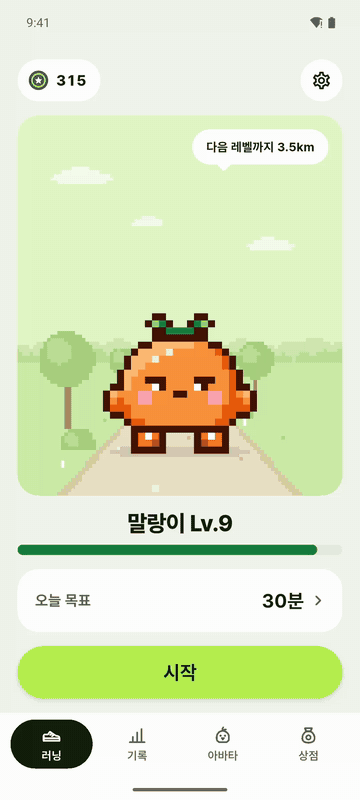
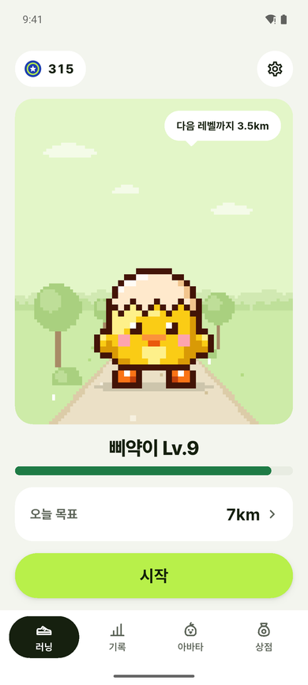
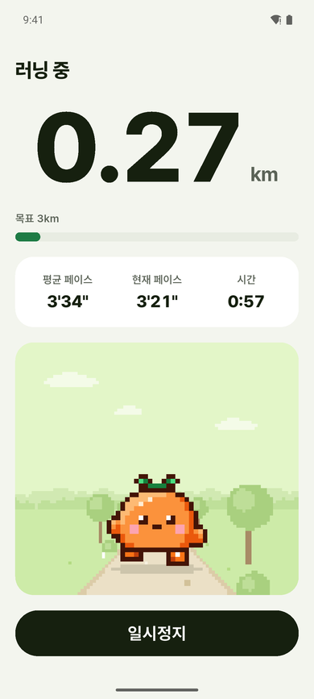
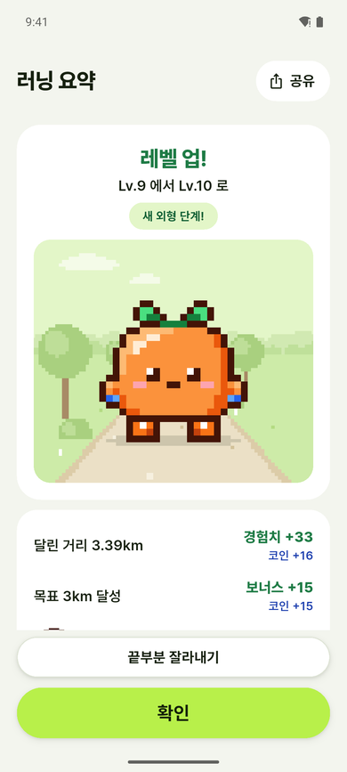
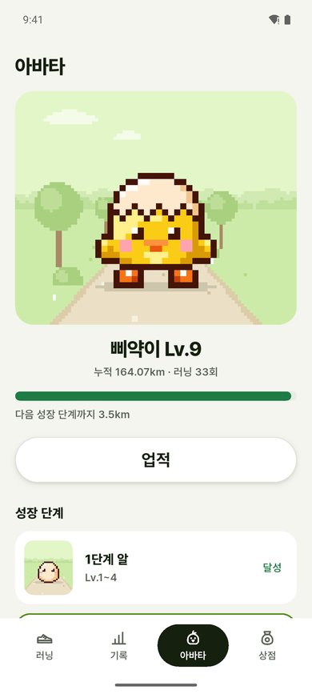
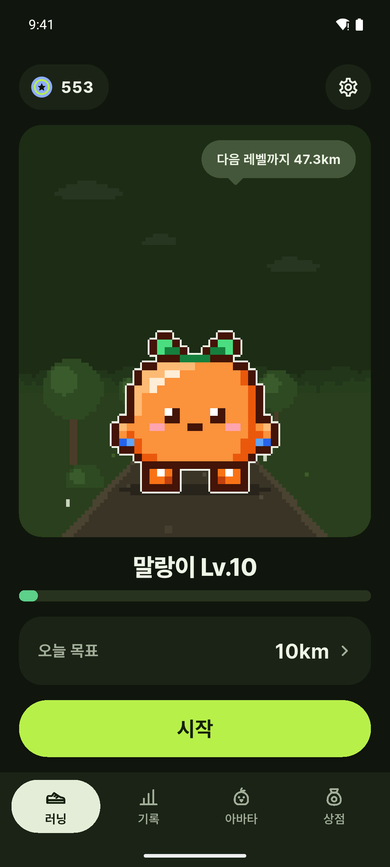
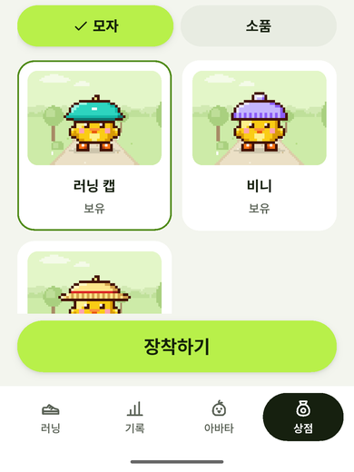

# 런마고치(runmagochi)

실제 러닝 기록(GPS·페이스)에 도트 아바타 육성을 더한 Android·iOS 러닝 앱. 달릴수록 캐릭터가 자라고, 오래 쉬면 졸린 표정을 짓는다. 서버 없이 기기 안에서 동작한다.

<p>
  
</p>

<p>
  
  
  
  
  
  
</p>

실제 앱 화면 59장 전체는 [화면설계서](https://dhkim1522.github.io/runmagochi/design/screens/)에 있고, 앱 소개는 [포트폴리오](https://dhkim1522.github.io/runmagochi/)에 있다.

## 기능

- **러닝 기록**: 거리·시간·페이스·구간 기록, 지도 경로. 화면을 꺼도 기록이 이어진다(Android 포그라운드 서비스, iOS 백그라운드 위치).
- **자동 보정**: 멈추면 자동 일시정지, 신호가 끊기거나 탈것으로 의심되면 구간을 제외하고 길어지면 자동 종료.
- **육성**: 러닝마다 경험치·코인을 받아 캐릭터 3종이 자란다. 레벨 업, 배지, 상점의 모자·소품.
- **기록 보기**: 주·월·연·전체 통계, 러닝 상세, 공유 카드.
- **알림 조작**: 알림에서 일시정지·재개·종료. 음성 안내.
- **내 데이터**: 백업 내보내기·가져오기, 라이트·다크 모드.

요구사항 전체는 [기획서](docs/product.md)(F1~F33)에 상태와 함께 있다.

## 기술

Flutter 3(FVM 고정) · Riverpod · Drift/SQLite(스키마 7판, 10개 표) · geolocator · flutter_local_notifications. `ui → app → domain ← data` 계층을 기능 폴더마다 둔다. 데이터 접근은 저장소 인터페이스를 거쳐 서버 이전 때 구현만 바꾼다(결정 0001).

## 산출물

개발 과정에서 만든 문서와 그림은 [포트폴리오 산출물 모음](docs/portfolio.md)에 모았고, 한 장으로 보는 정적 페이지 [포트폴리오](https://dhkim1522.github.io/runmagochi/design/portfolio/)도 있다. (HTML) 표시는 GitHub Pages 웹페이지로 열린다.

| 문서 | 내용 |
| --- | --- |
| [기획서](docs/product.md) | 목표, 요구사항, 범위 밖, 가정과 위험 |
| [유저 시나리오·흐름](docs/user-flows.md) | 시나리오 S1~S6, 예외 흐름, 화면 이동 |
| [화면설계서](https://dhkim1522.github.io/runmagochi/design/screens/) (HTML) | 실제 앱 화면 59장(라이트·다크·iPhone·알림), 화면별 요소·상태·인터랙션 |
| [화면 목록](docs/screens.md) | 화면 목록, 이동 흐름, UX 원칙 |
| [와이어프레임](design/wireframes/README.md) | 화면 콘티 |
| [디자인 시스템](https://dhkim1522.github.io/runmagochi/docs/design/design-system/) (HTML) · [규칙](docs/design/design-system.md) | 색·글꼴·간격 토큰, 컴포넌트 미리보기 |
| [디자인 과정](docs/design/design-process.md) · [UI 후보 비교](https://dhkim1522.github.io/runmagochi/design/mockups/phase-6/compare/) (HTML) | 방향 비교·선택·근거 |
| [캐릭터 에셋](https://dhkim1522.github.io/runmagochi/design/character/asset-catalog.html) (HTML) | 캐릭터 3종·단계·아이템·배지·앱 아이콘 |
| [설계서](docs/architecture.md) | 기술 스택, 모듈 지도, 플랫폼 경계 |
| [데이터 모델](docs/data-model.md) | ERD, 스키마 판 이력 |
| [시퀀스 다이어그램](docs/sequences.md) | 기록~보상, 알림 버튼, 자동 일시정지·종료, 백업 |
| [결정 기록](docs/decisions/README.md) | 결정 38개 색인과 흐름도 |
| [개발 기록](docs/dev-log.md) | 페이즈별 테스트 수 추이, 검증에서 잡은 결함 |
| [플레이북](docs/playbook.md) | 다음 프로젝트용 진행 순서와 규칙 |
| [로드맵](docs/roadmap.md) | 페이즈별 범위와 완료 기준, 현재 위치 |
| [기록 엔진](docs/specs/run-engine.md) · [게임 규칙](docs/specs/game-rules.md) | 동작 명세 |

## 개발 방법

기획·계획·구현·검증을 Claude Code 와 함께 페이즈 단위로 진행했다. 문서가 원천이고, 결정은 번호를 붙여 기록하며, 테스트가 통과한 상태로만 커밋한다. 에뮬레이터 E2E 로 단위 테스트가 놓친 결함을 잡았다. 과정은 [개발 기록](docs/dev-log.md)과 [플레이북](docs/playbook.md)에 있다.

처음 쓰는 PC 라면 저장소 폴더에서 Claude Code 를 열고 폴더를 신뢰한 뒤 `/kickoff` 로 현황을 보고 플러그인을 고른다. `/phase` 로 현재 페이즈를 진행한다(`/phase --auto` 는 계획 승인 없이 자동). 플러그인은 [개발 도구](docs/tooling.md)에 있다.

## 빌드·실행

Android SDK 플랫폼 37 과 [FVM](https://fvm.app) 이 필요하다. Flutter 버전은 `.fvmrc` 로 고정돼 있다(결정 0008). 처음 한 번 `fvm install` 을 실행한다.

```
fvm flutter pub get
fvm flutter run
```

DB 생성 코드(`app_database.g.dart`)는 저장소에 들어 있다. 테이블을 고쳤을 때만 `fvm dart run build_runner build` 로 다시 만든다. 테스트는 `fvm flutter test`. iOS 는 Mac 에서 빌드한다: [iOS 빌드](docs/ios.md). 릴리스 APK 서명은 [베타 배포](docs/beta.md)에 있다.
