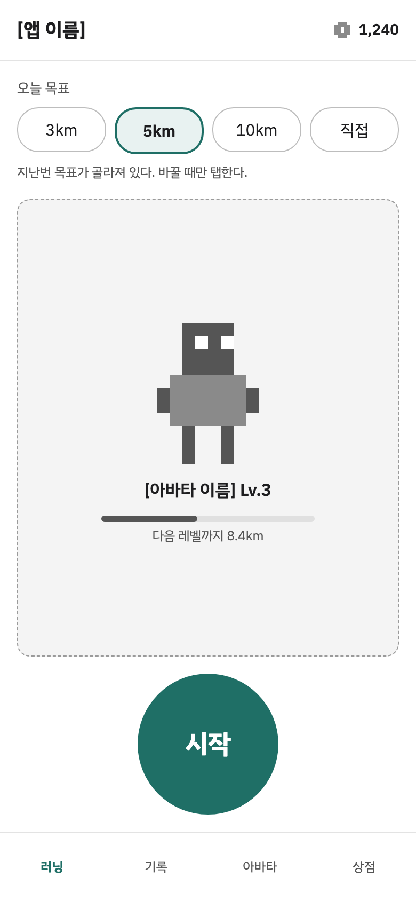
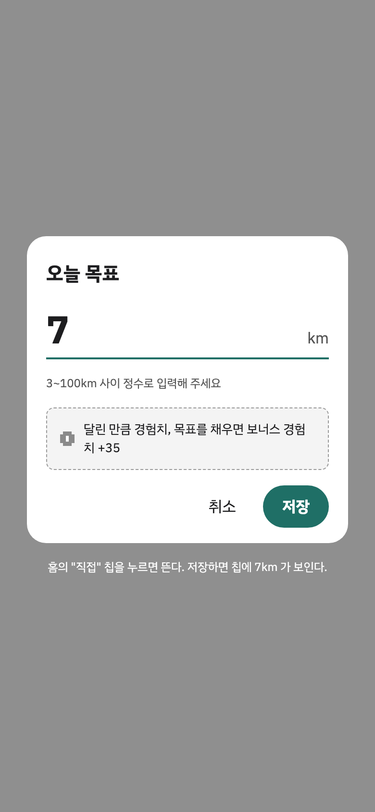
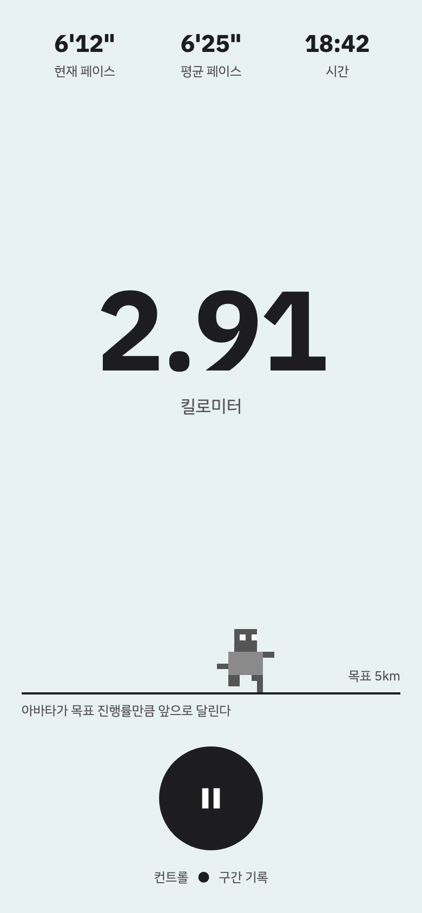
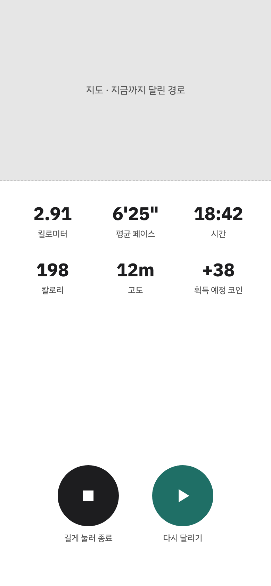
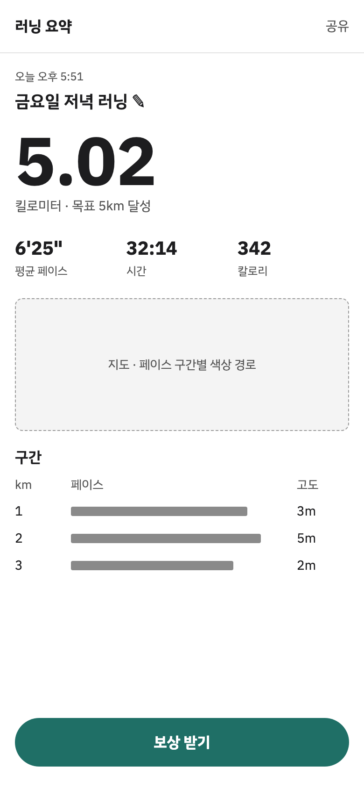
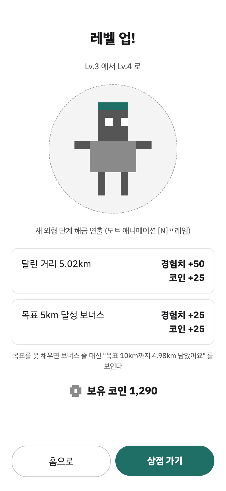
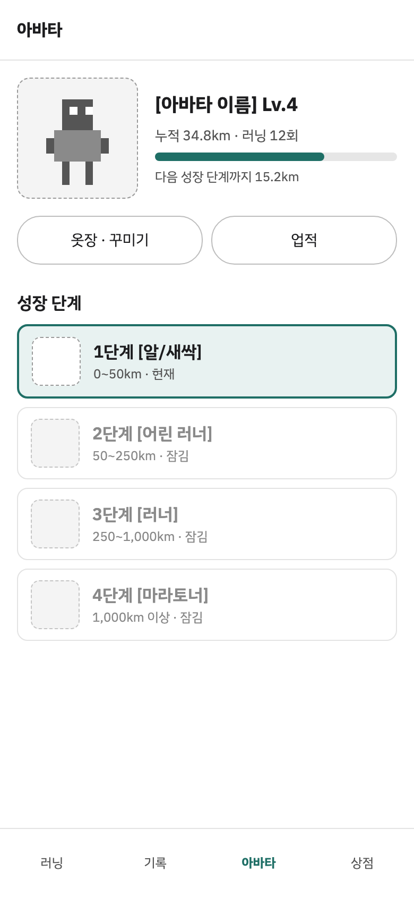
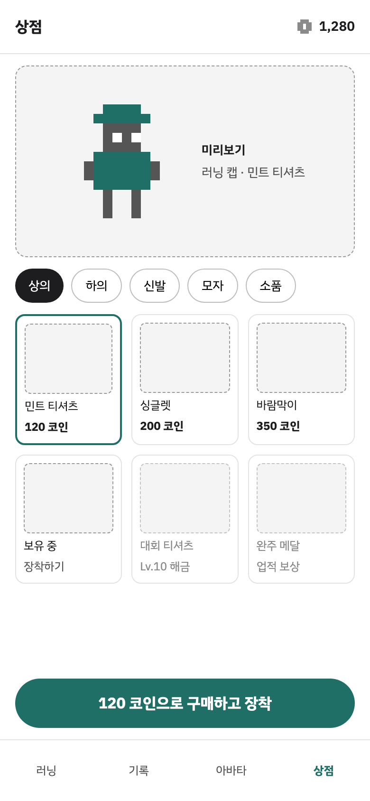
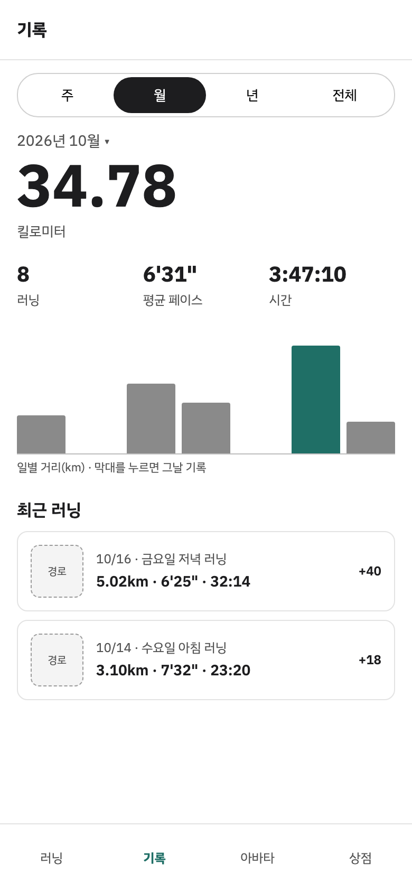
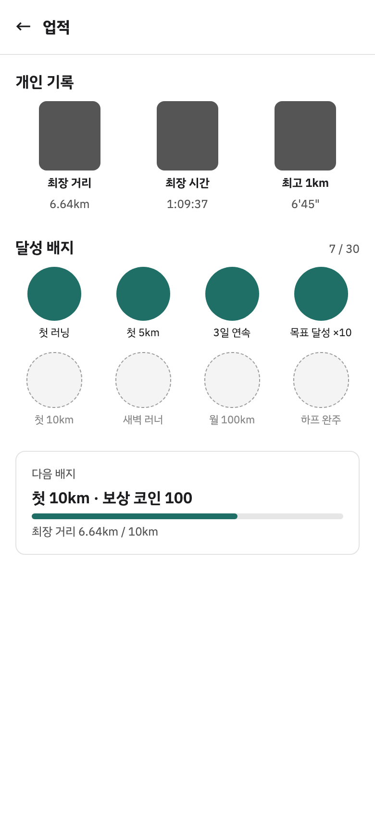

# 와이어프레임

> MVP 화면 10개의 콘티. 화면 역할과 이동 흐름은 [화면설계](../../docs/screens.md)에 있다.

- `*.html` — 원본. 브라우저로 열면 하단 탭과 버튼으로 화면 사이를 이동할 수 있다.
- `png/` — 화면 이미지 (390×844, 2배 해상도).
- 편집용 캔버스: [claude.ai 디자인 캔버스](https://claude.ai/artifact/GGgUf6VGKuK3AkSRxrEnoQ)

| 1 홈 | 2 목표 직접 입력 | 3 러닝 중 | 4 일시정지 | 5 러닝 요약 |
| --- | --- | --- | --- | --- |
|  |  |  |  |  |

| 6 보상 | 7 아바타 | 8 상점 | 9 기록 | 10 업적 |
| --- | --- | --- | --- | --- |
|  |  |  |  |  |
