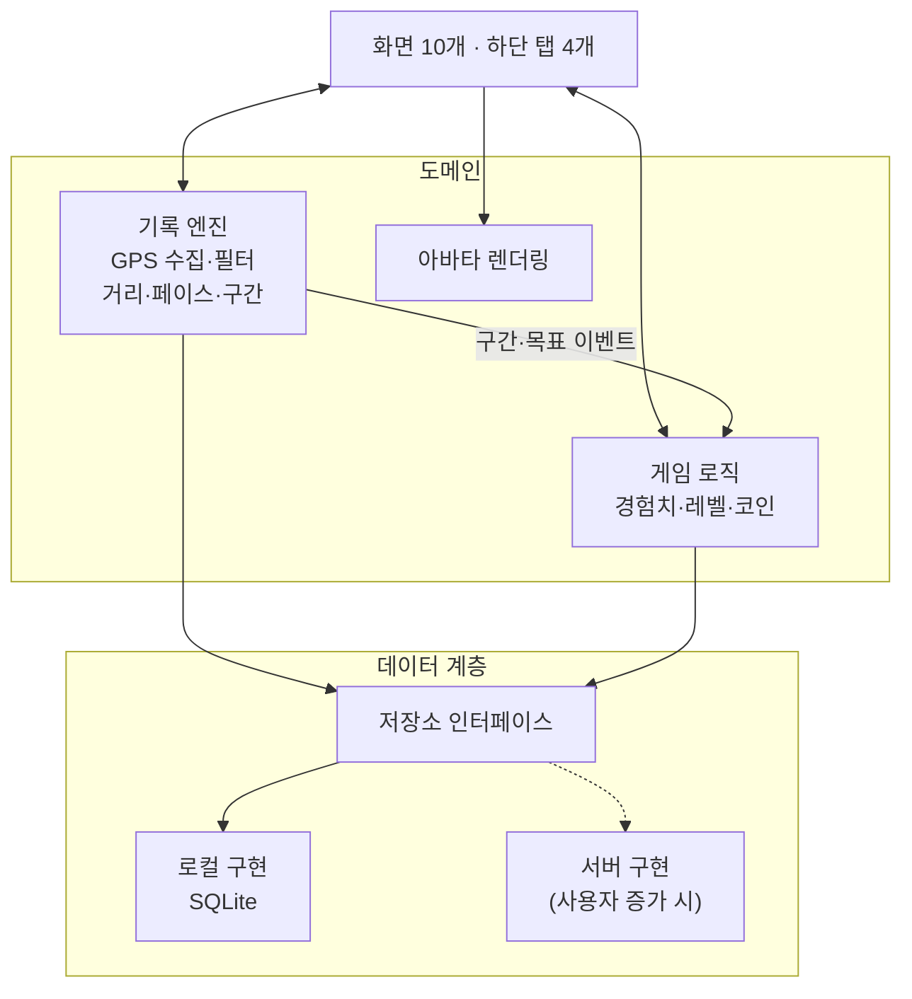

# 설계서

> 앱은 서버 없이 기기 안에서 모든 데이터를 저장·계산하는 로컬 우선 구조이며, 저장 계층을 분리해 나중에 서버로 옮길 수 있게 만든다.

## 기술 스택

**개발 프레임워크는 미결정**이다. Flutter를 추천한다. 도트 아바타 애니메이션을 게임 엔진(Flame)으로 그릴 수 있고, Android·iOS에서 화면이 픽셀 단위로 똑같이 나온다.

| 기준 | Flutter (추천) | React Native (Expo) |
| --- | --- | --- |
| 언어 | Dart | TypeScript |
| 도트 애니메이션 | Flame 엔진으로 스프라이트 시트 재생 | Skia·Lottie 조합, 게임용 도구는 약함 |
| 백그라운드 위치 | geolocator + 포그라운드 서비스 설정 | expo-location + TaskManager |
| 로컬 DB | drift (SQLite) | expo-sqlite, WatermelonDB |
| 화면 일관성 | 자체 렌더링, 플랫폼 차이 작음 | OS 기본 컴포넌트, 플랫폼별 차이 있음 |

### 라이브러리 (Flutter 기준)

- **위치**: `geolocator`
- **지도**: `google_maps_flutter`
- **로컬 DB**: `drift`
- **상태 관리**: `riverpod`
- **아바타 렌더링**: `flame`

## 구조

- **기록 엔진**은 화면과 분리된 독립 모듈이다. 1km 구간과 목표 달성을 이벤트로 내보낸다.
- **게임 로직**은 엔진 이벤트만 구독한다. 기록 코드와 게임 코드가 서로를 모른다.
- **저장소 인터페이스**는 화면·도메인이 저장 방식을 모르게 한다. 현재는 로컬 구현만 있다.

## 데이터 모델

모든 데이터는 기기의 SQLite에 저장한다. 서버로 옮길 때 그대로 동기화할 수 있도록 다음을 지킨다.

- 모든 행의 ID는 UUID다. 기기에서 만든 ID가 서버에서도 겹치지 않는다.
- 모든 행에 생성 시각(`createdAt`)과 수정 시각(`updatedAt`)을 둔다.
- 코인 잔액은 따로 저장하지 않고 지급·사용 내역(CoinTxn) 합계로 계산한다.

| 엔티티 | 주요 필드 |
| --- | --- |
| Profile | id, 닉네임, 체중 |
| Avatar | id, 이름, 레벨, 경험치, 성장 단계, 부위별 장착 아이템 |
| Run | id, 시작·종료 시각, 거리(m), 움직인 시간(초), 평균 페이스, 칼로리, 목표, 이름 |
| RunPoint | runId, 시각, 위도, 경도, 고도, 정확도, 속도 |
| Split | runId, km 순번, 시간, 페이스, 고도 변화 |
| Goal | id, 종류(주간 거리), 목표값, 기간 |
| CoinTxn | id, 금액(+/-), 사유(거리·목표·구매), runId |
| Item | id, 부위, 이름, 가격, 해금 조건, 스프라이트 경로 |
| Inventory | itemId, 획득 시각 |
| Badge | id, 이름, 조건, 보상 코인 |
| UserBadge | badgeId, 달성 시각, runId |

Item과 Badge 목록은 앱에 포함된 고정 데이터다.

## 백업과 복원

- **OS 기본 백업**: Android 자동 백업, iOS iCloud 백업에 DB 파일을 포함한다.
- **파일 내보내기·가져오기**: 전체 데이터를 파일 하나로 내보내고, 새 기기에서 가져온다.

## 서버 이전 경로

사용자가 늘어 서버가 필요해지면 다음 순서로 옮긴다.

1. 로그인을 추가하고, 기존 로컬 데이터를 계정에 연결한다.
2. 저장소 인터페이스에 서버 구현을 추가하고, 로컬 DB는 오프라인 캐시로 쓴다.
3. 보상 계산을 서버로 옮겨 조작을 막는다. 유료 아이템을 도입하기 전에는 반드시 마친다.

## 에셋 교체 구조

- **캐릭터 스프라이트**: 크기, 프레임 수, 부위별 레이어 규격을 먼저 정하고, 개발 중에는 같은 규격의 임시 스프라이트를 쓴다. 실제 에셋은 파일만 바꿔 적용한다.
- **디자인 값**: 색상, 글꼴, 간격은 테마 파일 하나에서 관리한다.
