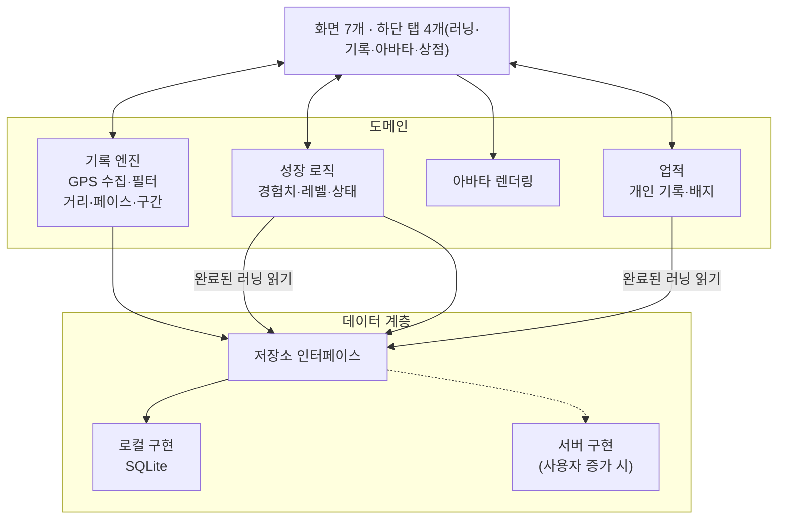
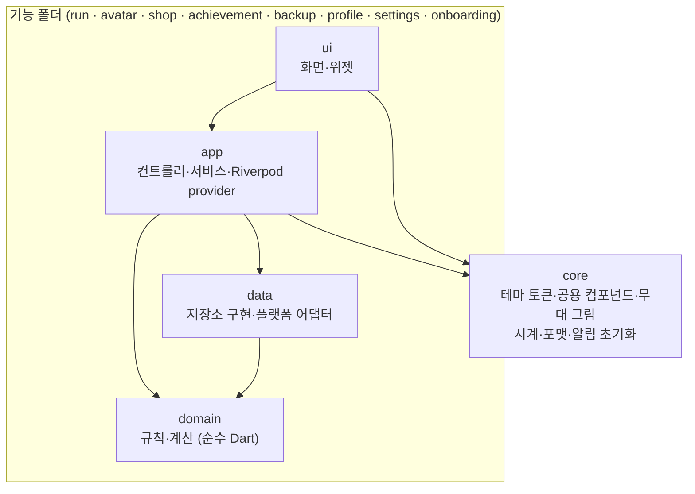
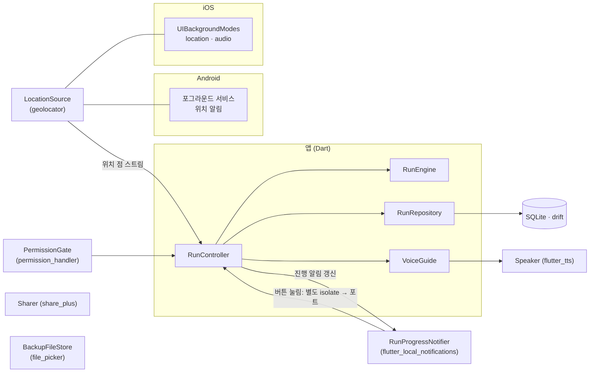

# 설계서

> 앱은 서버 없이 기기 안에서 모든 데이터를 저장·계산하는 로컬 우선 구조이며, 저장 계층을 분리해 나중에 서버로 옮길 수 있게 만든다.

## 기술 스택

Flutter로 개발한다. 근거는 [결정 0004](decisions/0004-flutter.md).

| 영역 | 선택 | 이유 |
| --- | --- | --- |
| 위치 | `geolocator` | 무료, 유지보수 활발. Android 포그라운드 서비스, iOS 백그라운드 위치 모드 지원 ([ios.md](ios.md)) |
| 경로 표시 | `CustomPainter` 로 경로 선만 그림 | 지도 API 키·계정 불필요, 오프라인 동작 |
| 로컬 DB | `drift` (SQLite) | 마이그레이션·타입 안전 쿼리, 서버 동기화에 맞는 관계형 구조 |
| 상태 관리 | `riverpod` (코드 생성 없이) | 기록 엔진의 이벤트 스트림을 화면에 연결 |
| 아바타 렌더링 | 일반 위젯 + 스프라이트 시트 | 프레임을 Ticker 로 넘긴다. 게임 엔진 불필요 |
| 음성 안내 | `flutter_tts` | 기기 음성 합성 엔진으로 한국어 안내, 다른 앱 소리 줄이기. `Speaker` 인터페이스 뒤에 둔다 ([결정 0024](decisions/0024-voice-share-packages.md)) |
| 공유 | `share_plus`, `path_provider` | 요약 카드 이미지를 임시 폴더에 쓰고 시스템 공유 창으로 보낸다. `Sharer` 인터페이스 뒤에 둔다 |
| 그래프 | `CustomPainter` | 통계 막대·구간 페이스 막대를 패키지 없이 그린다 |
| 권한 | `permission_handler` | 위치·알림 권한 요청과 배터리 최적화 예외 안내. `PermissionGate` 인터페이스 뒤에 둔다 |
| 백업 파일 | `file_picker`, `path_provider`, `uuid` | 백업 JSON 을 고르고 쓴다. 모든 행의 ID 는 UUID |
| 로컬 알림 | `flutter_local_notifications` | 러닝 진행 알림(거리·시간·목표 진행, 일시정지·재개 버튼), 종료 예고 알림, 자동 종료·목표 달성 즉시 알림 |

배경 지도가 필요해지면 `maplibre_gl` 또는 `flutter_map` 에 OpenFreeMap 타일을 쓴다. Google Maps는 API 키와 Google Cloud 프로젝트가 필요해 쓰지 않는다.

## 구조

- **기록 엔진**은 화면과 분리된 독립 모듈이다. 1km 구간과 러닝 종료를 이벤트로 내보낸다.
- **성장 로직**은 저장된 완료 러닝을 읽어 경험치를 계산한다. 기록 코드와 게임 코드는 서로를 모른다.
- **업적**은 완료 러닝에서 개인 기록과 배지를 계산한다. 성장 로직의 동기화 안에서 새 배지를 가려 코인과 함께 준다. 음성 안내와 공유 카드는 기록 엔진 이벤트와 요약을 읽기만 한다.
- **저장소 인터페이스**는 화면·도메인이 저장 방식을 모르게 한다. 현재는 로컬 구현만 있다.

### 모듈 지도

`lib/` 는 기능별 폴더로 나누고, 폴더 안은 같은 네 층으로 나눈다. 의존은 한 방향이다(`ui → app → domain ← data`). `domain` 은 Flutter 에 기대지 않는 순수 Dart 라 단위 테스트로 규칙을 검증한다.

| 폴더 | 책임 | 대표 파일 |
| --- | --- | --- |
| `run/` | 러닝 기록 전부: 엔진, 컨트롤러, 저장소, 위치 어댑터, 음성, 알림, 홈·러닝 중·요약·기록 화면, 공유 카드 | `domain/run_engine.dart`, `app/run_controller.dart`, `data/drift_run_repository.dart`, `data/app_database.dart` |
| `avatar/` | 경험치·레벨·외형 단계 규칙, 아바타 화면 | `domain/growth_rules.dart` |
| `shop/` | 코인·아이템 카탈로그, 구매·장착, 상점·코인 내역 화면 | `domain/catalog.dart` |
| `achievement/` | 개인 기록, 배지 12개와 지급, 업적 화면 | `domain/badges.dart`, `app/achievement_service.dart` |
| `backup/` | 백업 JSON 만들기·읽기·교체 | `domain/backup_codec.dart` |
| `profile/` | 체중·이름·화면 모드·음성 안내 설정과 첫 실행 여부 | `data/drift_profile_repository.dart` |
| `settings/`, `onboarding/` | 설정 화면, 첫 실행 2장 | |
| `core/` | 디자인 토큰(`theme.dart`), 공용 컴포넌트, 사각 무대 그림, 시계, 알림 초기화 | `theme.dart`, `ui/components.dart` |

### 플랫폼 경계

OS 기능은 인터페이스 뒤에 두어, 테스트는 가짜로 바꾸고 화면·규칙은 OS 를 모른다.

- **백그라운드 기록**: Android 는 geolocator 의 포그라운드 서비스 알림(위치 서비스 유형), iOS 는 `UIBackgroundModes` 의 `location`·`audio` 로 화면이 꺼져도 위치와 음성이 이어진다. 위치 갱신 간격은 필터 없이(`distanceFilter` 0) 받고 거름은 엔진이 한다 ([ios.md](ios.md), 결정 0031).
- **알림 버튼**: 버튼 응답은 별도 isolate 에서 오므로, 이름을 붙인 포트(`IsolateNameServer`)로 메인 isolate 에 버튼 id 를 보내고 `runNotificationActionsProvider` 스트림을 컨트롤러가 듣는다 ([시퀀스](sequences.md)).
- **강제 종료 복구**: 위치 점을 10초마다 DB 에 쓰므로 프로세스가 죽어도 다음 실행에서 복구 안내를 띄운다 (결정 0007).

### 의존성 주입과 상태

- `flutter_riverpod` 의 `Provider` 가 구현을 꽂는다(`lib/*/app/providers.dart`, 30여 개). 위치 원본·시계·저장소·음성·알림을 provider 로 받아, 테스트는 `ProviderScope` 의 override 로 가짜를 넣는다.
- 러닝 상태는 `RunController`(`NotifierProvider`)가 `RunViewState` 로 내보내고 화면은 읽기만 한다. 시간은 `clockProvider` 로 받아 테스트가 시간을 조작한다.
- 화면 간 전달은 DB 를 거친다. 러닝이 끝나면 저장 → 성장·업적 동기화가 완료된 러닝을 읽어 경험치·코인·배지를 계산한다.

## 데이터 모델

테이블 관계도(ERD)와 스키마 판 이력은 [데이터 모델](data-model.md)에 있다. 아래는 엔티티별 필드 설명이다.

모든 데이터는 기기의 SQLite에 저장한다. 서버로 옮길 때 그대로 동기화할 수 있도록 **모든 테이블**이 다음 필드를 가진다.

- `id`: UUID. 기기에서 만든 ID가 서버에서도 겹치지 않는다.
- `createdAt`, `updatedAt`: 생성·수정 시각
- `deletedAt`: 삭제 표시. 행을 지우지 않고 표시만 해서 나중에 서버에 삭제를 전달한다.

| 엔티티 | 주요 필드 |
| --- | --- |
| Profile | 체중(kg, 없으면 칼로리 65kg 기준), 첫 실행 완료 시각, 음성 안내 켜짐 여부(`voiceGuide`, 기본 켜짐), 화면 모드(`themeMode`: `system`·`light`·`dark`, 기본 `system`) |
| Avatar | 이름, 종류(chick·jelly·acorn 중 무작위, 바뀌지 않음, 결정 0011), 장착한 모자·소품 아이템 번호(없으면 비어 있음) (레벨·경험치는 XpTxn 합계, 마지막 러닝은 Runs 에서 계산) |
| Run | 시작·종료 시각, 거리(m), 움직인 시간(초), 평균 페이스, 칼로리, 이름, 압축 경로, 오늘 목표 거리(m) 또는 목표 시간(초, `goalSec`). 둘 중 하나만 채우고, 2026-10-20 이전 러닝은 둘 다 없음 |
| RunPoint | runId, segment, 시각, 위도, 경도, 정확도, 속도 (러닝 중에만 존재) |
| Split | runId, km 순번, 시간, 페이스 |
| WeeklyGoal | 주 시작일(현지 `YYYY-MM-DD`, 고유), 목표 거리(m), 달성 시각(없으면 미달성). 주간 목표가 후속 범위가 되어(결정 0018) 새로 쓰지 않고 기존 행만 남는다 |
| XpTxn | 경험치(+), 사유(거리·오늘 목표 달성·주간 목표), runId 또는 주 시작일. (runId, 사유)·(주 시작일, 사유)는 고유해서 같은 러닝·주에 두 번 쌓이지 않는다. 주간 목표 행은 기존 것만 남는다 |

| CoinTxn | 코인(지급 +, 구매 −), 사유(distance·runGoal·purchase·badge), runId 또는 itemId. (runId, 사유)는 고유해서 같은 러닝에 두 번 쌓이지 않는다. 배지 지급 코인은 runId 없이 쌓고, 중복은 Badge 의 배지 id 고유 키가 막는다 |
| Badge | 배지 id(고유), 받은 시각, 받게 한 runId(없을 수 있음). 배지 id 는 고유해서 같은 배지를 두 번 받지 않는다. 받은 뒤 러닝을 지워도 남는다 |
| OwnedItem | 보유한 아이템 번호. 아이템 번호는 고유해서 같은 아이템을 두 번 사지 않는다 |

경험치와 레벨은 XpTxn 합계로, 코인 잔액은 CoinTxn 합계로 계산한다. 아이템 목록(이름·부위·가격)은 코드의 카탈로그(`lib/shop/domain/catalog.dart`)에 있고 DB 에는 보유와 장착만 둔다. 배지 목록(이름·조건·코인)은 코드의 카탈로그(`lib/achievement/domain/badges.dart`)에 있고 DB 에는 받은 배지만 둔다. 개인 기록은 저장하지 않고 완료 러닝에서 그때그때 계산한다. 기록 통계(주·월·년·전체)도 완료 러닝을 한 번 읽어 메모리에서 묶는다.

### 경로 저장

- 러닝 중에는 위치 점을 RunPoint 에 10초마다 저장한다. 강제 종료 후 복구에 쓴다.
- RunPoint 의 `segment` 는 시작·재개부터 일시정지까지 이어서 기록한 점 묶음의 번호다. 0부터 빈 번호 없이 늘어난다.
- 진행 중 Run 의 움직인 시간은 점을 저장할 때마다 함께 갱신한다. 저장할 점이 없어도 10초마다 갱신한다.
- 강제 종료 후 다시 열면 점을 segment 별로 묶어 복원한다. 거리는 같은 segment 안의 점 사이만 더하고, 움직인 시간은 Run 에 저장된 값을 쓴다. segment 번호가 비어 있으면 복원하지 않는다 (결정 0007).
- 러닝이 끝나면 경로를 압축 문자열(encoded polyline)로 바꿔 Run 에 저장하고 RunPoint 를 지운다.
- 원본 점으로 30분 러닝은 약 180KB, 압축하면 약 10KB다(추정). 원본을 지우면 거리를 다시 계산할 수 없다.

## 백업과 복원

DB 스키마와 백업 파일 형식은 모두 7판이다. 이전 판 백업 파일도 가져온다(7판 미만 백업은 화면 모드를 `system` 으로 채운다).

- **주 수단**: 전체 데이터를 JSON 파일 하나로 내보내고, 새 기기에서 가져온다. 가져오면 기존 데이터를 모두 바꾼다. RunPoint·진행 중 러닝은 담지 않는다 ([결정 0015](decisions/0015-backup.md)).
- **보조 수단**: Android 자동 백업, iOS iCloud 백업. Android 자동 백업은 앱당 25MB 한도가 있고 실행이 보장되지 않는다.
- SQLite WAL 파일이 백업에 일관되게 담기는지는 복원 테스트로 확인한다.

## 서버 이전 경로

사용자가 늘어 서버가 필요해지면 다음 순서로 옮긴다.

1. 로그인을 추가하고, 기존 로컬 데이터를 계정에 연결한다.
2. 저장소 인터페이스에 서버 구현을 추가하고, 로컬 DB는 오프라인 캐시로 쓴다.
3. 보상 계산을 서버로 옮겨 조작을 막는다. 유료 아이템을 도입하기 전에는 반드시 마친다.

## 에셋 교체 구조

- **캐릭터 스프라이트**: 크기, 프레임 수, 부위별 레이어 규격을 먼저 정하고, 개발 중에는 같은 규격의 임시 스프라이트를 쓴다. 실제 에셋은 파일만 바꿔 적용한다.
- **디자인 값**: 색상, 글꼴, 간격은 테마 파일 하나에서 관리한다.
