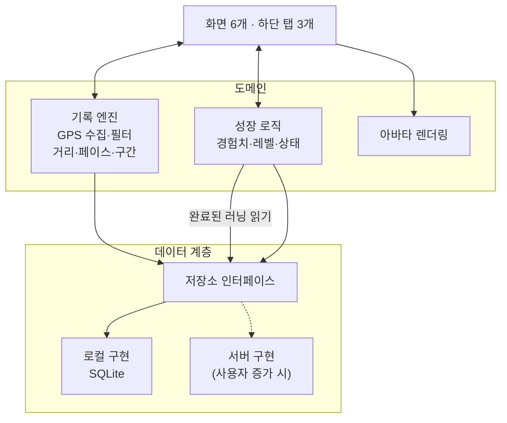

# 설계서

> 앱은 서버 없이 기기 안에서 모든 데이터를 저장·계산하는 로컬 우선 구조이며, 저장 계층을 분리해 나중에 서버로 옮길 수 있게 만든다.

## 기술 스택

Flutter로 개발한다. 근거는 [결정 0004](decisions/0004-flutter.md).

| 영역 | 선택 | 이유 |
| --- | --- | --- |
| 위치 | `geolocator` | 무료, 유지보수 활발. Android 포그라운드 서비스 지원 |
| 경로 표시 | `CustomPainter` 로 경로 선만 그림 | 지도 API 키·계정 불필요, 오프라인 동작 |
| 로컬 DB | `drift` (SQLite) | 마이그레이션·타입 안전 쿼리, 서버 동기화에 맞는 관계형 구조 |
| 상태 관리 | `riverpod` (코드 생성 없이) | 기록 엔진의 이벤트 스트림을 화면에 연결 |
| 아바타 렌더링 | 일반 위젯 + 스프라이트 시트 | 프레임을 Ticker 로 넘긴다. 게임 엔진 불필요 |
| 로컬 알림 | `flutter_local_notifications` | 주간 목표 잔여 알림 |

배경 지도가 필요해지면 `maplibre_gl` 또는 `flutter_map` 에 OpenFreeMap 타일을 쓴다. Google Maps는 API 키와 Google Cloud 프로젝트가 필요해 쓰지 않는다.

## 구조

- **기록 엔진**은 화면과 분리된 독립 모듈이다. 1km 구간과 러닝 종료를 이벤트로 내보낸다.
- **성장 로직**은 저장된 완료 러닝을 읽어 경험치를 계산한다. 기록 코드와 게임 코드는 서로를 모른다.
- **저장소 인터페이스**는 화면·도메인이 저장 방식을 모르게 한다. 현재는 로컬 구현만 있다.

## 데이터 모델

모든 데이터는 기기의 SQLite에 저장한다. 서버로 옮길 때 그대로 동기화할 수 있도록 **모든 테이블**이 다음 필드를 가진다.

- `id`: UUID. 기기에서 만든 ID가 서버에서도 겹치지 않는다.
- `createdAt`, `updatedAt`: 생성·수정 시각
- `deletedAt`: 삭제 표시. 행을 지우지 않고 표시만 해서 나중에 서버에 삭제를 전달한다.

| 엔티티 | 주요 필드 |
| --- | --- |
| Profile | 닉네임, 체중 |
| Avatar | 이름, 종류(chick·jelly·acorn 중 무작위, 바뀌지 않음, 결정 0011) (레벨·경험치는 XpTxn 합계, 마지막 러닝은 Runs 에서 계산) |
| Run | 시작·종료 시각, 거리(m), 움직인 시간(초), 평균 페이스, 칼로리, 이름, 압축 경로 |
| RunPoint | runId, segment, 시각, 위도, 경도, 정확도, 속도 (러닝 중에만 존재) |
| Split | runId, km 순번, 시간, 페이스 |
| WeeklyGoal | 주 시작일(현지 `YYYY-MM-DD`, 고유), 목표 거리(m), 달성 시각(없으면 미달성) |
| XpTxn | 경험치(+), 사유(거리·주간 목표), runId 또는 주 시작일. (runId, 사유)·(주 시작일, 사유)는 고유해서 같은 러닝·주에 두 번 쌓이지 않는다 |

경험치와 레벨은 XpTxn 합계로 계산한다. 코인(CoinTxn), 아이템, 배지 테이블은 후속 페이즈에서 같은 원칙으로 추가한다.

### 경로 저장

- 러닝 중에는 위치 점을 RunPoint 에 10초마다 저장한다. 강제 종료 후 복구에 쓴다.
- RunPoint 의 `segment` 는 시작·재개부터 일시정지까지 이어서 기록한 점 묶음의 번호다. 0부터 빈 번호 없이 늘어난다.
- 진행 중 Run 의 움직인 시간은 점을 저장할 때마다 함께 갱신한다. 저장할 점이 없어도 10초마다 갱신한다.
- 강제 종료 후 다시 열면 점을 segment 별로 묶어 복원한다. 거리는 같은 segment 안의 점 사이만 더하고, 움직인 시간은 Run 에 저장된 값을 쓴다. segment 번호가 비어 있으면 복원하지 않는다 (결정 0007).
- 러닝이 끝나면 경로를 압축 문자열(encoded polyline)로 바꿔 Run 에 저장하고 RunPoint 를 지운다.
- 원본 점으로 30분 러닝은 약 180KB, 압축하면 약 10KB다(추정). 원본을 지우면 거리를 다시 계산할 수 없다.

## 백업과 복원

- **주 수단**: 전체 데이터를 파일 하나로 내보내고, 새 기기에서 가져온다.
- **보조 수단**: Android 자동 백업, iOS iCloud 백업. Android 자동 백업은 앱당 25MB 한도가 있고 실행이 보장되지 않는다.
- SQLite WAL 파일이 백업에 일관되게 담기는지는 복원 테스트로 확인한다.

## 서버 이전 경로

사용자가 늘어 서버가 필요해지면 다음 순서로 옮긴다.

1. 로그인을 추가하고, 기존 로컬 데이터를 계정에 연결한다.
2. 저장소 인터페이스에 서버 구현을 추가하고, 로컬 DB는 오프라인 캐시로 쓴다.
3. 보상 계산을 서버로 옮겨 조작을 막는다. 유료 아이템을 도입하기 전에는 반드시 마친다.

## 에셋 교체 구조

- **캐릭터 스프라이트**: 크기, 프레임 수, 부위별 레이어 규격을 먼저 정하고, 개발 중에는 같은 규격의 임시 스프라이트를 쓴다. 실제 에셋은 파일만 바꿔 적용한다.
- **디자인 값**: 색상, 글꼴, 간격은 테마 파일 하나에서 관리한다.
