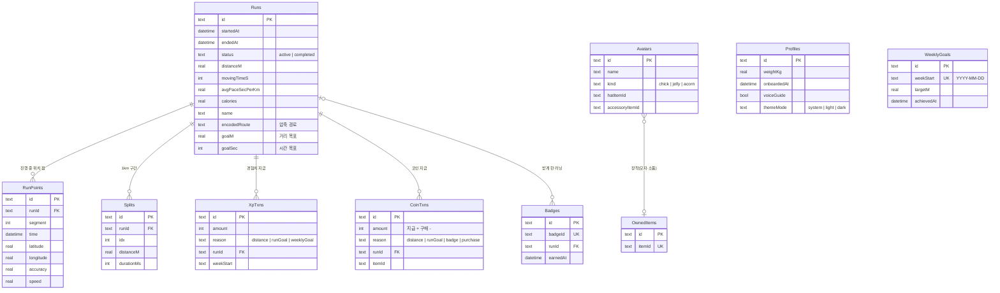

# 데이터 모델 (ERD)

> 기기의 SQLite(drift)에 저장하는 테이블 10개와 관계. 원본은 `lib/run/data/app_database.dart` 이고(스키마 7판), 이 문서의 테이블 목록은 `test/docs/data_model_doc_test.dart` 가 코드와 같은지 검사한다. 필드 설명과 규칙은 [설계서](architecture.md#데이터-모델), 계산 규칙은 [게임 규칙](specs/game-rules.md) (2026-10-23).

## ERD

모든 테이블은 위 필드 말고도 `createdAt`·`updatedAt`·`deletedAt` 을 가진다(그림에서 생략). 삭제는 `deletedAt` 표시로만 하고, 날짜·시각은 ISO-8601 문자열로 저장한다.

## 관계와 규칙

| 관계 | 설명 |
| --- | --- |
| Runs – RunPoints | 러닝 중에만 존재. 러닝이 끝나면 경로를 압축 문자열로 `Runs.encodedRoute` 에 옮기고 점을 지운다 (진행 중이던 러닝의 복구용) |
| Runs – Splits | 1km 구간 기록. 구간 시간으로 페이스를 계산한다 |
| Runs – XpTxns / CoinTxns | 러닝마다 사유별로 한 번만 지급(고유 키 `(runId, reason)`). 같은 러닝을 다시 판정해도 행이 늘지 않는다 |
| Runs – Badges | 배지를 받게 한 러닝. 러닝을 지워도 배지는 남는다(`runId` 비어도 됨). 같은 배지는 한 번만(`badgeId` 고유) |
| Avatars – OwnedItems | 장착한 모자·소품은 `itemId` 로 가리킨다. 외래 키는 걸지 않았다(아이템 목록은 코드 카탈로그에 있고 DB 에는 보유만 둔다) |
| Profiles, WeeklyGoals | 다른 테이블과 이어지지 않는다. WeeklyGoals 는 주간 목표 제거(결정 0018) 뒤 새로 쓰지 않고 기존 행만 남는다 |

경험치·레벨은 XpTxns 합계, 코인 잔액은 CoinTxns 합계로 계산한다. 레벨·외형 단계·개인 기록·통계는 저장하지 않고 완료 러닝에서 그때그때 계산한다.

## 스키마 판 이력

| 판 | 페이즈 | 변경 |
| --- | --- | --- |
| 1 | 1 | Runs, RunPoints, Splits |
| 2 | 2 | Avatars, WeeklyGoals, XpTxns |
| 3 | 3 | Profiles (체중·첫 실행) |
| 4 | 3.5 | Runs.goalM (오늘 목표 거리) |
| 5 | 4 | CoinTxns, OwnedItems, Avatars.hatItemId·accessoryItemId |
| 6 | 5 | Runs.goalSec (시간 목표), Profiles.voiceGuide, Badges |
| 7 | 6 | Profiles.themeMode (화면 모드) |

업그레이드는 `onUpgrade` 에서 판마다 단계적으로 실행한다. 백업 파일 형식도 같은 7판이고 이전 판 백업을 가져온다 ([백업과 복원](architecture.md#백업과-복원)).

## 서버 이전을 위한 설계

- 기본 키는 모두 UUID 라 기기끼리 겹치지 않는다.
- 행을 지우지 않고 `deletedAt` 으로 표시해 나중에 삭제를 서버에 전할 수 있다.
- 고유 키가 중복 지급을 막아 서버 동기화 때도 같은 규칙이 이어진다 ([서버 이전 경로](architecture.md#서버-이전-경로)).
