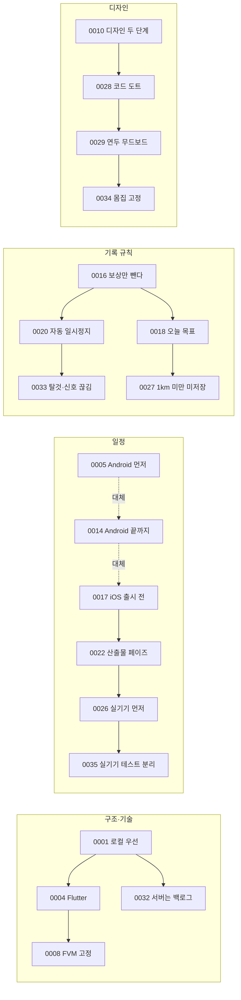

# 결정 기록 색인

> 주요 결정 36개의 목록. 원본은 이 폴더의 `NNNN-이름.md` 이고, 새 결정은 다음 번호로 추가한다(`docs/roadmap.md` 작업 규칙). 번호는 시간순이며 한 결정이 앞선 결정을 고치면 상태 열에 관계를 적는다 (2026-10-23).

각 결정 파일은 상태·날짜, 배경, 결정, 결과 순으로 쓴다. 한 결정이 다른 결정의 일부만 바꾸면 "일부 대체"로 적었다.

## 흐름으로 보는 결정

## 색인

| 번호 | 제목 | 분야 | 상태 | 날짜 |
| --- | --- | --- | --- | --- |
| [0001](0001-local-first.md) | 로컬 우선 구조 | 구조 | 채택 | 2026-10-16 |
| [0002](0002-docs-in-repo.md) | 원천 문서를 저장소에 둔다 | 프로세스 | 채택 | 2026-10-16 |
| [0003](0003-defer-rewards.md) | 보상 기능을 후속 페이즈로 둔다 | 범위 | 채택 | 2026-10-16 |
| [0004](0004-flutter.md) | Flutter 채택 | 기술 | 채택 | 2026-10-16 |
| [0005](0005-android-first.md) | Android 먼저, iOS는 페이즈 3 | 일정 | 대체됨 (0014) | 2026-10-16 |
| [0006](0006-phase1-packages.md) | 페이즈 1 패키지와 권한 범위 | 기술 | 채택 | 2026-10-16 |
| [0007](0007-segment-restore.md) | segment 단위 저장과 복원 | 기록 | 채택 | 2026-10-16 |
| [0008](0008-fvm-flutter-version.md) | FVM 으로 Flutter 버전 고정 | 기술 | 채택 | 2026-10-17 |
| [0009](0009-phase2-packages.md) | 페이즈 2 추가 패키지 | 기술 | 채택 | 2026-10-17 |
| [0010](0010-design-phases.md) | 디자인을 기본(2.5)과 완성(6) 두 단계로 나눈다 | 디자인 | 채택 | 2026-10-17 |
| [0011](0011-random-avatar-kind.md) | 캐릭터는 3종 중 무작위로 정해지고 바뀌지 않는다 | 제품 | 채택 | 2026-10-18 |
| [0012](0012-market-positioning.md) | 러닝 중심 포지션 유지와 시장조사 반영 | 제품 | 일부 대체 (0025·0036) | 2026-10-18 |
| [0013](0013-pet-runner.md) | 캐릭터 콘셉트는 "펫 러너" | 제품 | 채택 | 2026-10-18 |
| [0014](0014-android-first-release.md) | Android 로 끝까지 만들어 출시하고, iOS 는 마지막 페이즈로 | 일정 | 대체됨 (0017) | 2026-10-18 |
| [0015](0015-backup.md) | 백업은 JSON 파일 하나로 내보내고, 가져오면 전체를 바꾼다 | 데이터 | 채택 | 2026-10-18 |
| [0016](0016-run-integrity.md) | 기록 이상 처리: 기록은 살리고 보상만 뺀다 | 기록 | 일부 대체 (0018·0020·0033) | 2026-10-18 |
| [0017](0017-ios-before-release.md) | iOS 를 출시 전에 붙이고, Android 와 iOS 를 동시에 출시 | 일정 | 일부 보완 (0022·0023·0026·0035) | 2026-10-20 |
| [0018](0018-run-goal-rewards.md) | 오늘 목표를 정하고 달리며, 목표 달성으로 보상을 나눈다 | 제품 | 일부 대체 (0033) | 2026-10-20 |
| [0019](0019-run-notification-share.md) | 러닝 알림에 실시간 진행을 보이고, 요약 공유 카드를 더한다 | 기능 | 채택 | 2026-10-21 |
| [0020](0020-auto-pause-idle-end.md) | 멈추면 자동 일시정지하고, 오래 멈추면 예고 뒤 끝낸다 | 기록 | 채택 | 2026-10-21 |
| [0021](0021-run-notification-overwrite.md) | 러닝 진행 알림은 위치 서비스 알림에 같은 번호로 덮어쓴다 | 기능 | 채택 | 2026-10-21 |
| [0022](0022-deliverables-phase.md) | 디자인 다음에 산출물 정리 페이즈를 둔다 | 일정 | 일부 변경 (0026·0035) | 2026-10-21 |
| [0023](0023-backlog-health-race.md) | 건강 연동과 레이스는 첫 출시에서 빼고 백로그로 둔다 | 범위 | 채택 | 2026-10-21 |
| [0024](0024-voice-share-packages.md) | 음성 안내는 flutter_tts, 공유는 share_plus 를 쓴다 | 기술 | 채택 | 2026-10-21 |
| [0025](0025-app-name-runmagochi.md) | 앱 이름은 런마고치로 간다 | 제품 | 채택 | 2026-10-21 |
| [0026](0026-real-device-before-deliverables.md) | 실기기 확인을 산출물 정리 앞에 두고, 출시는 써 본 뒤 정한다 | 일정 | 일부 변경 (0035) | 2026-10-21 |
| [0027](0027-short-runs.md) | 1km 미만 러닝은 저장하지 않는다 | 기록 | 채택 | 2026-10-21 |
| [0028](0028-design-assets.md) | 디자인 에셋은 코드 도트와 도구 스크립트로 만든다 | 디자인 | 채택 | 2026-10-22 |
| [0029](0029-ui-direction-lime.md) | UI 방향을 연두 무드보드(c · 캔버스)로 바꾼다 | 디자인 | 채택 | 2026-10-22 |
| [0030](0030-ios-track-early.md) | iOS 대응을 페이즈 6 과 나란히 먼저 시작한다 | 일정 | 채택 | 2026-10-22 |
| [0031](0031-ios-cocoapods-background.md) | iOS 는 CocoaPods 로 빌드하고 백그라운드 위치·소리를 켠다 | 기술 | 채택 | 2026-10-22 |
| [0032](0032-account-server-backlog.md) | 로그인·서버를 확장 백로그에 올린다 | 범위 | 채택 | 2026-10-22 |
| [0033](0033-abuse-signal-handling.md) | 어뷰징·위치 처리: 탈것 의심 구간 빼기, 신호 끊김 상태, 친절한 안내 | 기록 | 채택 | 2026-10-23 |
| [0034](0034-fixed-body-growth.md) | 성장 표현: 몸집 고정 | 디자인 | 채택 | 2026-10-23 |
| [0035](0035-field-test-phase.md) | 실기기 테스트를 별도 페이즈 9 로 분리하고 이후 번호를 한 칸씩 미룬다 | 일정 | 채택 | 2026-10-23 |
| [0036](0036-reset-and-onboarding-card.md) | 설정에 초기화를 넣고, 첫 실행의 "걷다 뛰다 OK" 카드를 뺀다 | 제품 | 채택 | 2026-10-24 |

## 분야별 요약

- **구조·기술**: 서버 없이 기기에서 동작(0001)하고 Flutter(0004)로 Android·iOS 를 한 코드로 만든다. 버전은 FVM 으로 고정(0008). 위치·DB·알림·음성·공유 패키지는 0006·0009·0024.
- **기록 규칙**: 기록은 살리고 보상만 조절한다(0016). 오늘 목표(0018)와 자동 일시정지·종료(0020), 1km 미만은 저장 안 함(0027), 탈것 의심·신호 끊김(0033)은 실기기 실측(페이즈 9)에서 숫자를 조정한다.
- **제품**: 캐릭터는 3종 중 무작위(0011), 콘셉트는 펫 러너(0013), 이름은 런마고치(0025), 설정 초기화와 첫 실행 카드 정리(0036).
- **디자인**: 기본(2.5)과 완성(6) 두 단계(0010), 에셋은 코드 도트(0028), 방향은 연두 무드보드(0029), 성장 표현은 몸집 고정(0034).
- **일정**: Android 먼저(0005) → Android 로 끝까지(0014) → iOS 를 출시 전에 붙이고 동시 출시(0017) → 산출물 정리 페이즈(0022) → 실기기 먼저(0026) → 실기기 테스트 별도 페이즈(0035). 현재 순서는 [로드맵](../roadmap.md).
- **범위**: 보상은 후속(0003), 건강 연동·레이스는 백로그(0023), 로그인·서버는 백로그(0032).
