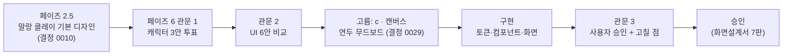

# 디자인 의사결정 기록

> 페이즈 2.5 의 기본 디자인에서 페이즈 6 의 출시 품질 디자인까지, 무엇을 비교해 무엇을 왜 골랐는지 한 장으로 정리한다. 값과 규칙은 [디자인 시스템](design-system.md)·`tokens.json`, 화면은 [화면설계서](../screens.md), 계획과 작업 기록은 [페이즈 6 계획](../plans/phase-6.md)에 있다 (2026-10-23).

## 흐름

## 결정과 근거

| 단계 | 비교한 것 | 고른 것 | 근거 |
| --- | --- | --- | --- |
| 에셋 수단 | Aseprite · 픽셀 생성 AI · 이미지 생성 모델 · 외주 | 코드 도트(`tool/sprites/` → PNG) | 프레임·기준점·단계별 얼굴 위치를 코드 규격에 맞추기 쉽고 비용이 없다 (결정 0028) |
| 관문 1 캐릭터 | 그림체 후보 A·B·C (같은 병아리 1~4단계와 달리기) | **A 말랑 클레이** | 주변에 보여 주고 투표. 기준점은 현재 값 유지 |
| 관문 2 UI 방향 | 3방향(a 말랑 클레이 다듬기 · b 도트 한 칸 · c 연두 무드보드) × 2트랙(디자인 스킬 HTML · Claude Design 캔버스) = 6안 | **c · 캔버스** | 점수 추천은 b · 캔버스(27/30)였으나, 마스코트가 화면의 주인공인 c(20/30)를 사용자가 골랐다. 고르기 전에 연두 원을 사각 무대로 바꿔 배경 아이템을 깔 수 있게 했다 (결정 0029) |
| 몸집 성장 | 단계마다 몸이 넓어지는 안 · 폭 고정 안 | 2단계 이후 폭 고정, 키·외관·장비로 성장 | 넓어지면 살찐 느낌 (결정 0034) |
| 버튼 모양 | 진한 테두리 · 옅은 플로팅 그림자 | 그림자 `elevation-float` | 관문 3 이후 의견, 비교 C 안 (작업 31) |
| 경로 색 | 보라 포함 3단 · 연두 한 계열 3단 | 연두 한 계열(천천히·보통·빠르게) | 색각 이상 포함 서로 CIEDE2000 15.6 이상 (작업 29·30) |

## 도구 사용

| 도구 | 쓴 곳 | 결과 |
| --- | --- | --- |
| ui-ux-pro-max | 방향 a·c 의 HTML 시안 | a 는 기존 토큰 유지. c 는 추천(어두운 바탕·주황)이 무드보드와 맞지 않아 무드보드에서 뽑은 값을 썼다 |
| Taste Skill | 방향 b 고르기 | 도트 한 칸 모티프. 점수 1위였으나 선택되지 않음 |
| Impeccable critique | 6안 비교 | 6개 항목 30점 + 검출기. 접근성 수치(가로 넘침·최소 글자 13px·대비)를 공통으로 잰 표가 [critique](../../design/mockups/phase-6/critique.md)에 있다 |
| Claude Design 캔버스 | 트랙 2 아트보드 9개 | [캔버스](https://claude.ai/artifact/FxKS7MR2twYmmE3k6SzNhe) |

## 산출물 위치

| 산출물 | 위치 |
| --- | --- |
| 디자인 시스템 | [아티팩트](https://claude.ai/artifact/FPihTBfX2CJserHVwUQ514), [문서](design-system.md), 값 `tokens.json`, 코드 `lib/core/theme.dart` |
| 고른 시안·규칙 | `design/mockups/phase-6/` (`direction-c.md`, `canvas/c/`) |
| 6안 비교 | [critique](../../design/mockups/phase-6/critique.md), [비교 아티팩트](https://claude.ai/artifact/F5MsvhPE9fAXw5YtCwe3Xc) |
| 캐릭터·아이템·배지 | `design/character/`, [에셋 카탈로그](https://claude.ai/artifact/ECbG2Fh4TXQwcr5fNUWCXA) |
| 구현 화면 | `design/mockups/phase-6-screens/`, 화면설계서 `design/screens/` |
| 옛 방향(말랑 클레이) | `design/mockups/*.dc.html`, git 기록 |

## 코드와의 일치

색·글꼴·간격·움직임·선 두께 토큰은 `test/core/theme_test.dart` 가 `tokens.json` 과 `lib/core/theme.dart` 값이 같은지 라이트·다크 모두 검사한다. 화면 코드에는 HEX 를 쓰지 않는다. 무대 배경 그림의 색만 `lib/core/stage/` 에 있고 값은 `tokens.json` 의 `stageScene` 이 기준이다.
