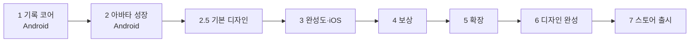

# 로드맵

> 페이즈별 개발 범위와 완료 기준. 각 페이즈는 완료 기준을 통과해야 다음으로 넘어가고, 스토어 출시는 모든 페이즈를 마친 뒤 한다.

## 현재 위치

**페이즈 2 구현 완료, 사람 확인 대기**. 실기기 확인이 남았다. 다음은 페이즈 2.5 기본 디자인. 진행 상태는 [페이즈 2 구현 계획](plans/phase-2.md).

페이즈 1도 실기기 실측(30분 러닝 3회, 트랙 거리 오차)이 남아 있다. [페이즈 1 구현 계획](plans/phase-1.md).

## 페이즈

### 페이즈 1 기록 코어

- **범위**
  - 러닝 시작·일시정지·재개·종료, 3초 카운트다운 (F1)
  - 거리·평균 페이스·시간 실시간 표시 (F2)
  - 1km 구간 기록, 요약 화면 경로 선 (F3)
  - 포그라운드 서비스 백그라운드 기록, 강제 종료 후 복구, 위치 권한·배터리 최적화 예외 안내 (F17)
  - 기록 목록·상세·주간 합계 (F5)
  - 로컬 DB, 저장소 인터페이스, 경로 압축 저장
  - 화면: 홈(아바타 자리는 빈 칸), 러닝 중, 일시정지, 러닝 요약, 기록
- **완료 기준**
  - 기록 엔진 단위 테스트 통과
  - 에뮬레이터 가상 GPS로 화면 꺼짐 기록 확인
  - Android 실기기로 실제 30분 러닝 3회, 기록 누락 0건, 거리 오차 5% 이내

### 페이즈 2 아바타 성장

- **범위**
  - 경험치·레벨·외형 단계 (F7)
  - 러닝 중 달리는 아바타, 페이스별 걷기·달리기 동작 (F8)
  - 요약 화면의 경험치 획득·레벨업 연출
  - 주간 목표, 연속 달성 주수 (F6)
  - 아바타 상태 표정, 주간 목표 잔여 로컬 알림 (F18)
  - 아바타 화면
  - 기본 캐릭터 1종의 외형 4단계와 걷기·달리기 스프라이트. 스프라이트 규격(크기, 프레임 수, 부위별 레이어) 확정
- **완료 기준**
  - 실제 러닝 1회로 경험치 획득부터 레벨업 연출까지 확인
  - 지인 베타에서 아바타 때문에 다시 달리고 싶은지 의견 수집

### 페이즈 2.5 기본 디자인 (무료, MVP 수준)

베타 전에 기본 첫인상을 갖춘다. 무료 수단(Claude 디자인 도구·코드로 그린 도트)만 쓰고, 출시 수준 다듬기는 페이즈 6 에서 한다 (결정 0010).

- **범위**
  - 디자인 시스템(색·글꼴·간격·컴포넌트)을 Claude Design System 아티팩트와 `ui-ux-pro-max` 로 만든다
  - Design 캔버스로 MVP 화면 6개 시안을 만들어 승인받은 뒤 Flutter 테마·화면에 적용한다
  - 캐릭터: Claude 가 코드로 도트를 찍어(팔레트 + 프레임별 픽셀 격자 → PNG) 콘셉트 2~3안을 만들고, 고른 안으로 4단계·표정·걷기/달리기를 그린다(페이즈 2 작업 11 대체)
  - 디자인 값은 테마 파일 하나, 캐릭터는 규격과 PNG 파일로 분리해 페이즈 6 에서 교체만 하면 되게 한다
- **완료 기준**
  - 디자인 시스템·화면 시안·캐릭터 콘셉트를 사용자가 승인
  - 앱에 적용되고 에뮬레이터 E2E 통과

### 페이즈 3 완성도·iOS

- **범위**
  - 첫 실행 화면(처음 만나는 캐릭터 소개·이름 짓기·주간 목표, 결정 0011), 설정 화면
  - 백업 파일 내보내기·가져오기 (F12)
  - 러닝 삭제, 끝부분 잘라내기 (F16)
  - 페이즈 2.5 디자인을 나머지 화면(첫 실행·설정)에 적용
  - iOS 대응: 백그라운드 위치, 권한 문구, iPhone 실측
  - Apple 개발자 계정 구입, TestFlight 배포
- **완료 기준**
  - iPhone 실기기로 실제 30분 러닝 3회, 기록 누락 0건
  - 다른 기기로 백업 복원 성공
  - Android·iOS 지인 베타 배포

### 페이즈 4 보상

- **범위**: 코인 지급·내역 (F9), 상점 (F10), 꾸미기 (F11), 부위별 아이템 스프라이트
- **완료 기준**: 러닝 1회로 코인 수령부터 구매·장착까지 완료

### 페이즈 5 확장

- **범위**: 자동 일시정지 (F4), 페이스 그래프·월·년 통계 (F5-2), 러닝별 목표 (F6-2), 음성 안내 (F14), 건강 연동 (F15), 업적·배지 (F19)
- **완료 기준**: 기능별로 페이즈 착수 시 정한다

### 페이즈 6 디자인 완성

모든 기능 페이즈를 마친 뒤, 출시해도 될 수준으로 UI/UX 와 그림을 다듬는다 (결정 0010).

- **범위**
  - UI/UX 전면 점검: 화면별 시각 완성도, 애니메이션·전환, 빈 상태·오류 화면, 접근성(글자 크기·대비)
  - 캐릭터 4단계·표정·동작, 배경, 아이템(페이즈 4), 배지(페이즈 5), 앱 아이콘·스플래시
  - 에셋 수단 비교 검토 후 결정: Aseprite 직접 작업, 픽셀 전용 생성 AI, 이미지 생성 모델, 외주·에셋 구매. 정한 수단에 맞춰 스프라이트 규격(크기·프레임 수)을 다시 확정한다
- **완료 기준**
  - 사용자가 출시 품질로 승인
  - 바뀐 디자인으로 에뮬레이터 E2E 와 실기기 확인 통과

### 페이즈 7 스토어 출시

- **범위**: 정식 앱 이름 확정(상표 확인), 스토어 설명·스크린샷, 개인정보 처리방침, Play·App Store 심사
- **완료 기준**: 양쪽 스토어 심사 통과

## 테스트와 배포

| 대상 | 페이즈 1~2 | 페이즈 3 이후 |
| --- | --- | --- |
| 본인 테스트 | Android 에뮬레이터, Android 실기기 | Android·iPhone 실기기 |
| 지인 베타 | Android APK 직접 전달 | Android APK, iOS TestFlight |

실측은 본인의 실제 러닝으로 한다. Android 실기기는 가족 휴대폰을 쓴다.

## 확정된 제약

- 러닝 기록이 가장 먼저 동작해야 한다. 나머지 기능은 모두 기록 위에 얹힌다.
- Android로 먼저 개발·검증하고 iOS는 페이즈 3에서 붙인다. 근거는 [결정 0005](decisions/0005-android-first.md).
- 코인·상점·꾸미기·업적은 아바타 성장 뒤에 개발한다. 근거는 [결정 0003](decisions/0003-defer-rewards.md).
- 서버는 사용자가 늘어날 때 도입한다. 근거는 [결정 0001](decisions/0001-local-first.md).
- 수동 기록 입력(러닝머신)은 범위 밖이다.
