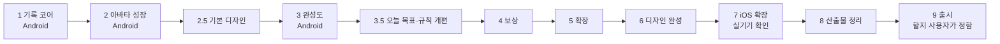

# 로드맵

> 페이즈별 개발 범위와 완료 기준. 각 페이즈는 완료 기준을 통과해야 다음으로 넘어가고, 스토어 출시는 모든 페이즈를 마친 뒤 한다.

## 현재 위치

**페이즈 6 디자인 완성 착수 전.** 페이즈 5 는 지금 확인할 수 있는 항목을 마쳤다 ([계획](plans/phase-5.md)).

페이즈 1~3 의 실기기 확인과 지인 베타는 페이즈 7 에서 Android·iPhone 함께 한다 ([1](plans/phase-1.md), [2](plans/phase-2.md), [2.5](plans/phase-2.5.md), [3](plans/phase-3.md), [3.5](plans/phase-3.5.md), [4](plans/phase-4.md), [5](plans/phase-5.md) 의 "사람 확인", 결정 0017).

## 페이즈

### 페이즈 1 기록 코어

- **범위**
  - 러닝 시작·일시정지·재개·종료, 3초 카운트다운 (F1)
  - 거리·평균 페이스·시간 실시간 표시 (F2)
  - 1km 구간 기록, 요약 화면 경로 선 (F3)
  - 포그라운드 서비스 백그라운드 기록, 강제 종료 후 복구, 위치 권한·배터리 최적화 예외 안내 (F17)
  - 기록 목록·상세·주간 합계 (F5)
  - 로컬 DB, 저장소 인터페이스, 경로 압축 저장
  - 화면: 홈(아바타 자리는 빈 칸), 러닝 중, 일시정지, 러닝 요약, 기록
- **완료 기준**
  - 기록 엔진 단위 테스트 통과
  - 에뮬레이터 가상 GPS로 화면 꺼짐 기록 확인
  - Android 실기기로 실제 30분 러닝 3회, 기록 누락 0건, 거리 오차 5% 이내

### 페이즈 2 아바타 성장

- **범위**
  - 경험치·레벨·외형 단계 (F7)
  - 러닝 중 달리는 아바타, 페이스별 걷기·달리기 동작 (F8)
  - 요약 화면의 경험치 획득·레벨업 연출
  - 주간 목표, 연속 달성 주수 (F6)
  - 아바타 상태 표정, 주간 목표 잔여 로컬 알림 (F18)
  - 아바타 화면
  - 기본 캐릭터 1종의 외형 4단계와 걷기·달리기 스프라이트. 스프라이트 규격(크기, 프레임 수, 부위별 레이어) 확정
- **완료 기준**
  - 실제 러닝 1회로 경험치 획득부터 레벨업 연출까지 확인
  - 지인 베타에서 아바타 때문에 다시 달리고 싶은지 의견 수집

### 페이즈 2.5 기본 디자인 (무료, MVP 수준)

베타 전에 기본 첫인상을 갖춘다. 무료 수단(Claude 디자인 도구·코드로 그린 도트)만 쓰고, 출시 수준 다듬기는 페이즈 6 에서 한다 (결정 0010).

- **범위**
  - 디자인 시스템(색·글꼴·간격·컴포넌트)을 Claude Design System 아티팩트와 `ui-ux-pro-max` 로 만든다
  - Design 캔버스로 MVP 화면 6개 시안을 만들어 승인받은 뒤 Flutter 테마·화면에 적용한다
  - 캐릭터: Claude 가 코드로 도트를 찍어(팔레트 + 프레임별 픽셀 격자 → PNG) 콘셉트 2~3안을 만들고, 고른 안으로 4단계·표정·걷기/달리기를 그린다(페이즈 2 작업 11 대체)
  - 디자인 값은 테마 파일 하나, 캐릭터는 규격과 PNG 파일로 분리해 페이즈 6 에서 교체만 하면 되게 한다
- **완료 기준**
  - 디자인 시스템·화면 시안·캐릭터 콘셉트를 사용자가 승인
  - 앱에 적용되고 에뮬레이터 E2E 통과

### 페이즈 3 완성도 (Android)

- **범위**
  - 착수 전 경쟁 앱 재확인: 스토어에서 A 범주(GPS 러닝·걸음 펫)를 다시 보고 `docs/research/market.md` 갱신 (결정 0012)
  - 첫 실행 화면(처음 만나는 캐릭터 소개·이름 짓기·주간 목표, 결정 0011). 첫 1~2주 애착이 핵심이고, "걷다 뛰다 OK" 를 안내한다 (결정 0012)
  - 설정 화면
  - 백업 파일 내보내기·가져오기 (F12)
  - 러닝 삭제, 끝부분 잘라내기 (F16)
  - 페이즈 2.5 디자인을 새 화면(첫 실행·설정)에 적용
  - 잔여 정리: 다크 모드 캐릭터 윤곽, 홈 로딩 한 줄 점프, 글자 크기 22 토큰, 탭 키보드 포커스 (결정 0014)
- **완료 기준**
  - 에뮬레이터 E2E 통과
  - 다른 Android 기기로 백업 복원, 지인 베타는 페이즈 7 에서 확인한다 (결정 0017·0026)

### 페이즈 3.5 오늘 목표와 보상 규칙

시작 흐름과 보상 규칙을 보상 페이즈 전에 바꾼다 (결정 0018).

- **범위**
  - 오늘 목표 (F6): 홈에서 3·5·10km·직접 입력(3~42km)으로 고르고 시작. 기본값은 지난번 목표, 처음은 3km. 목표는 러닝 기록에 저장
  - 러닝 중 목표 진행 표시, 목표에 닿으면 진동과 "목표 달성!" 한 번, 기록은 계속
  - 보상: 거리 경험치는 그대로, 목표를 채우면 달성 보너스(목표 1km당 5). 요약 화면에 달성·미달 구분
  - 주간 목표 제거: 홈 주간 목표 카드·연속 달성 주수, 첫 실행 3장(주간 목표), 설정의 주간 목표, 주간 달성 보너스, 금요일 알림
  - 러닝 삭제는 보상을 무르지 않음. 끝부분 잘라내기는 거리 경험치와 달성을 다시 판정
  - 빠른 이동 자동 종료: 시속 30km 초과가 30초 이어지면 자동 종료
  - 디자인: 홈·러닝 중·요약·첫 실행·설정을 기존 디자인 시스템으로 고친다. 시안은 `design/mockups/` 에 반영
- **완료 기준**
  - 홈에서 시작 버튼 한 번으로 지난번 목표로 달린다
  - 목표 달성 러닝과 미달 러닝의 보상이 요약에 다르게 보인다
  - 에뮬레이터 E2E 통과. 실기기 확인은 페이즈 7

### 페이즈 4 보상

- **범위**: 러닝 알림 실시간 진행·일시정지·재개 버튼 (F20, 결정 0019), 자동 일시정지·재개와 무활동 종료 예고 (F4, 결정 0020). 이 둘을 페이즈 첫 작업으로 한다. 코인 지급·내역 (F9), 상점 (F10), 꾸미기 (F11), 부위별 아이템 스프라이트(페이즈 6-1 에서 캐릭터 그림체에 맞춰 다시 그리므로 최소 개수만). 첫 수익은 꾸미기 팩 또는 한 번 후원으로 하고 광고·구독은 넣지 않는다 (결정 0012)
- **완료 기준**
  - 화면을 끈 러닝 중 알림창에서 거리·시간이 바뀌고, 알림 버튼으로 일시정지·재개된다 (에뮬레이터 E2E)
  - 가상 GPS 를 멈추면 자동 일시정지, 다시 움직이면 자동 재개, 5분 멈추면 30초 예고 뒤 종료 (에뮬레이터 E2E)
  - 러닝 1회로 코인 수령부터 구매·장착까지 완료

### 페이즈 5 확장

- **범위**: 페이스 그래프·월·년 통계 (F5-2), 시간 목표 (F6-2), 음성 안내 (F14), 업적·배지 (F19), 요약 공유 이미지 카드 (F21, 기능만. 카드 모양은 6-2 에서 다듬는다)
- **백로그**: 레이스(F6-4), 건강 연동(F15)은 첫 출시에서 뺀다 (결정 0023)
- **이름**: 런마고치로 정했다. 대안 후보 조사는 `docs/research/naming.md` (결정 0025)
- **완료 기준**: 기능별로 페이즈 착수 시 정한다

### 페이즈 6 디자인 완성

모든 기능 페이즈를 마친 뒤, 출시해도 될 수준으로 UI/UX 와 그림을 다듬는다 (결정 0010).

캐릭터를 먼저 정하고, 정한 캐릭터에 맞춰 화면을 고친다. 단계마다 후보 3개를 만들어 비교한 뒤 고른다.

- **6-1 캐릭터 에셋**
  - 에셋 수단 비교: Aseprite 직접 작업, 픽셀 전용 생성 AI, 이미지 생성 모델, 외주·에셋 구매
  - 후보 3개를 `design/candidates/character/a`, `b`, `c` 에 만든다. 같은 대상(병아리 1~4단계와 달리기)으로 그려 비교한다
  - 주변에 보여 주고 투표로 고른다
  - 고른 안으로 캐릭터 3종의 4단계·표정·동작, 아이템(페이즈 4), 배지(페이즈 5)를 그린다
  - 프레임 크기는 32×32px 로 고정한다. 프레임 수는 고른 수단에 맞춰 다시 정한다
- **6-2 UI/UX 개편**
  - 홈·러닝 중·요약 3개 화면으로 후보 시안 3개를 HTML 로 만들어 `design/candidates/ui/a`, `b`, `c` 에 둔다
    - 현재 말랑 클레이를 다듬은 안
    - Taste Skill 이 제시한 방향
    - 무드보드 `design/references/` 방향
  - Impeccable `critique` 로 비교하고 사용자가 고른다. 도구는 `docs/tooling.md`
  - 전면 점검: 화면별 시각 완성도, 애니메이션·전환, 빈 상태·오류 화면, 접근성(글자 크기·대비)
  - 배경, 앱 아이콘·스플래시
  - 경로 선을 페이스별 색으로 나눠 그리기, 공유 카드 디자인 (결정 0019)
  - 번들 글꼴 용량 줄이기: Noto Sans KR 가변 글꼴(약 10MB)을 KS X 1001 한글 + 영문으로 서브셋하거나 고정 굵기 파일로 바꾼다(약 8MB 절감 예상)
- 고른 안은 `design/character/`·`design/mockups/`·`docs/design/tokens.json` 에 반영하고 `design/candidates/` 는 지운다
- **완료 기준**
  - 캐릭터는 투표 결과로, 화면은 사용자가 출시 품질로 승인
  - 바뀐 디자인으로 에뮬레이터 E2E 통과. 실기기 확인은 페이즈 7

### 페이즈 7 iOS 확장과 실기기 확인

기능·디자인을 마친 앱에 iOS 를 붙이고, Xcode 로 본인 iPhone 에 설치해 Android 와 함께 실제로 써 본다 (결정 0017·0026). Mac 에서만 진행한다.

- **범위**
  - iOS 빌드 (회사 Mac, FVM·Xcode)
  - iOS 대응: 백그라운드 위치(`CLBackgroundActivitySession` 필요 여부), 권한 문구, 알림 초기화, 음성 안내 오디오 세션, 공유
  - 무료 Apple ID 로 본인 iPhone 에 직접 설치한다. 설치본은 7일마다 다시 설치한다
  - Android·iPhone 실기기 확인: 페이즈 1~6 의 "사람 확인" 항목
  - 써 보고 나온 고칠 점을 고친다
  - Android 지인 베타: 릴리스 APK 직접 공유, 의견 수집("아바타 때문에 다시 달리고 싶은지" 포함)
- **완료 기준**
  - Android·iPhone 실기기로 각각 실제 30분 러닝 3회, 기록 누락 0건, 트랙 거리 오차 5% 이내
  - 페이즈 1~6 의 "사람 확인" 항목 통과
  - Android 지인 베타 의견 수집

### 페이즈 8 산출물 정리

실기기로 확인을 마친 앱을 기준으로 개발 산출물을 포트폴리오로 쓸 수 있게 정리하고, 다음 프로젝트에 쓸 진행 순서를 남긴다 (결정 0022·0026).

- **범위**
  - 요구사항 정의서(PRD): `docs/product.md` 정리
  - 유저 시나리오: 사용자 흐름 다이어그램 추가
  - 화면설계서·와이어프레임: 최종 화면 기준으로 갱신
  - UI 시안·디자인 시스템: 페이즈 6-2 결과 정리
  - 시스템 아키텍처: 구성도 보강
  - 데이터 모델 ERD
  - 시퀀스 다이어그램: 러닝 기록부터 종료·보상까지, 알림 버튼, 자동 일시정지와 종료, 백업
  - 결정 기록 모음, 페이즈별 개발 기록(테스트 수, 리뷰에서 잡은 결함), README 소개(스크린샷·GIF)
  - 다음 프로젝트용 플레이북 `docs/playbook.md`: 산출물을 먼저 만들고 진행하는 페이즈 순서. 다른 프로젝트에서 쓸 스킬로도 만든다
- **제외**: API 명세(서버 없음), 테스트 케이스 문서(테스트 코드가 원본), 일정표(WBS)
- **완료 기준**
  - 위 산출물이 모두 있고 코드와 맞는다
  - 사용자가 포트폴리오로 쓸 수 있는 수준으로 승인

### 페이즈 9 출시

직접 써 본 결과로 출시할지 사용자가 정한다. 출시하면 Google Play 와 App Store 에 동시에 낸다 (결정 0017·0026).

- **범위**
  - 앱 이름 런마고치의 상표 충돌 확인(KIPRIS "런마고치"·"마고치"·"Tamagotchi", 결정 0025), 착수 전 경쟁 앱 재확인
  - 기록 이상 판별 강화: 걸음 센서로 자전거·차량 구간 판별, 이상 기록 저장 경고, 베타 기록으로 기준값 조정 (결정 0016)
  - App Store 결제(꾸미기 팩·후원)
  - Google Play 개발자 계정, Play 내부 테스트
  - Apple 개발자 계정 구입, TestFlight 로 iOS 지인 베타, 결제 확인
  - 스토어 설명·스크린샷, 개인정보 처리방침
  - Play 심사(백그라운드 위치 신고 포함), App Store 심사("항상 허용" 위치 사용 설명 포함)
- **완료 기준**: Google Play·App Store 심사 통과, 동시 출시

## 테스트와 배포

| 대상 | 페이즈 1~6 | 페이즈 7 | 페이즈 9 |
| --- | --- | --- | --- |
| 본인 테스트 | Android 에뮬레이터 | Android·iPhone 실기기, iOS 시뮬레이터 | Play 내부 테스트, TestFlight |
| 지인 베타 | 없음 | Android 릴리스 APK 직접 전달 | Play 내부 테스트, iOS TestFlight |

실측은 본인의 실제 러닝으로 한다. Android 실기기는 가족 휴대폰, iPhone 은 본인 휴대폰을 쓴다.

## 확정된 제약

- 러닝 기록이 가장 먼저 동작해야 한다. 나머지 기능은 모두 기록 위에 얹힌다.
- 페이즈 4~6 은 Android 기준으로 만들고, 페이즈 7 에서 iOS 를 붙여 실기기로 확인한다. 출시는 페이즈 9 에서 사용자가 정하며, 하면 Android·iOS 를 동시에 낸다. 근거는 [결정 0017](decisions/0017-ios-before-release.md)·[결정 0022](decisions/0022-deliverables-phase.md)·[결정 0026](decisions/0026-real-device-before-deliverables.md).
- 코인·상점·꾸미기·업적은 아바타 성장 뒤에 개발한다. 근거는 [결정 0003](decisions/0003-defer-rewards.md).
- 서버는 사용자가 늘어날 때 도입한다. 근거는 [결정 0001](decisions/0001-local-first.md).
- 수동 기록 입력(러닝머신)은 범위 밖이다.
