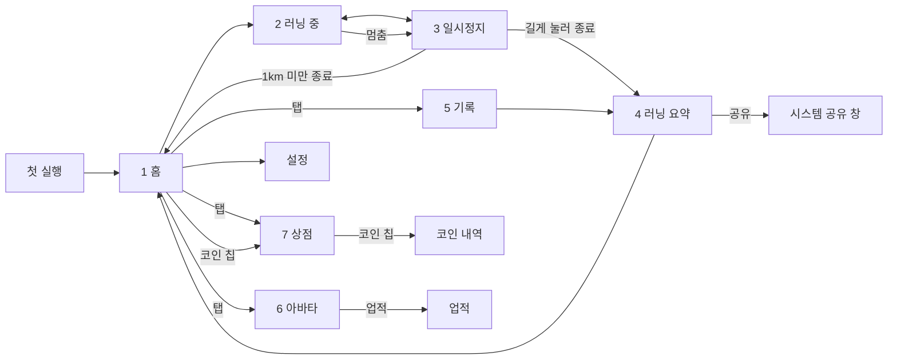

# 화면설계

> MVP 화면 7개와 코인 내역의 역할과 이동 흐름. 배치는 [와이어프레임](../design/wireframes/README.md)을 따른다.

와이어프레임은 화면 구성을 정하는 콘티다. 실제 UI 디자인은 페이즈 6 에서 연두 무드보드 + 사각 무대(결정 0029)로 입혔다. 화면별 모양은 아래 "화면 디자인", 규칙은 [디자인 시스템](design/design-system.md), 구현 스크린샷은 `design/mockups/phase-6-screens/`.

**화면설계서**: [Claude 아티팩트](https://claude.ai/artifact/456dWcNyLn1vbUsjV9FLVc) (2026-10-22, 작업 19). 실제 앱 화면 52장(Android 라이트 39·다크 8, iPhone 5)으로 만든 전체 화면 보드·흐름도·화면별 상세·와이어프레임·부품 모음. 원본은 `design/screens/`(스크린샷 `<번호>-<이름>.png`, 게시용 390px 사본 `web/`, 페이지 `index.html`).

## MVP 화면

요구사항 ID는 [기획서](product.md#기능-요구사항)를 가리킨다.

| # | 화면 | 핵심 기능 | 요구사항 | 와이어프레임 |
| --- | --- | --- | --- | --- |
| 1 | 홈 | 아바타·레벨·표정, 코인 잔액 칩(누르면 상점), 오늘 목표 한 줄(`오늘 목표 5km ›`, 누르면 아래 시트: `거리`·`시간` 분할, 자주 쓰는 값 칩 3·5·10km 또는 20·30·60분, 휠 3~42km 1km 단위·15~180분 5분 단위, `확인`), 시작 버튼 | F1, F6, F6-2, F7, F18 | 1 홈 + 2 목표 직접 입력(지금은 홈 한 줄 + 목표 시트. 직접 입력 창 대신 휠로 고른다, 작업 21) |
| 2 | 러닝 중 | 거리 크게, 목표(거리 또는 시간) 진행·달성 표시, 평균 페이스·시간, 달리는 아바타, 일시정지 버튼. 멈추면 자동 일시정지로 바뀐다 | F1, F2, F4, F6, F6-2, F8, F14 | 3 러닝 중 |
| 3 | 일시정지 | 지표 요약, 길게 눌러 종료, 재개. 자동 일시정지면 "멈춰서 일시정지했어요" 안내와 `일시정지` 버튼을 더한다. 버튼을 누르면 사용자 일시정지로 바뀐다. 탈것 의심·신호 끊김이면 무대 말풍선으로 까닭("혹시 뭘 타셨나요? 이 구간은 기록에서 뺄게요", "신호가 끊겼어요. 밖으로 나오면 다시 찾을게요")을 알리고 같은 두 버튼을 둔다(결정 0033). | F1, F4 | 4 일시정지 (지도 제외) |
| 4 | 러닝 요약 | 거리·페이스·시간, 목표 달성·미달, 경로 선, 구간 표, 구간 페이스 막대 그래프, 거리 경험치·달성 보너스와 각 줄의 `코인 +N`, 새 배지 줄, 레벨업 연출, 끝부분 잘라내기, 오른쪽 위 `공유`(카드 이미지) | F3, F6, F6-2, F7, F16, F19, F21 | 5 러닝 요약 + 6 보상 |
| 5 | 기록 | 주·월·년·전체 탭, 기간 이동, 합계(거리·러닝 횟수·평균 페이스·시간)와 막대 그래프, 최근 러닝 목록, 러닝 삭제 | F5, F5-2, F16 | 9 기록 (주간만) |
| 6 | 아바타 | 현재 레벨, 다음 외형 단계까지 남은 경험치, 외형 단계 목록, `업적` 화면으로 가는 입구 | F7, F19 | 7 아바타 |
| 7 | 상점 | 코인 잔액 칩(누르면 코인 내역), 모자·소품 탭, 아이템 미리보기·구매 확인·장착·벗기 | F9, F10, F11 | 8 상점 |

하단 탭은 러닝, 기록, 아바타, 상점 4개다. 다음 화면도 개발 범위지만 기본 패턴을 따르므로 와이어프레임이 없다.

- 첫 실행: 무작위로 정해진 캐릭터 소개·이름 짓기 2장(결정 0011·0018). 옛 시안 `design/mockups/Onboarding1~2.dc.html`(말랑 클레이). 한 번만 보이고, 마치기 전에는 홈(권한 안내·기록 복구 창 포함)을 만들지 않는다. 기존 사용자도 한 번 보며, 이름은 바꾼 이름이 있으면 그대로 둔다. 2장에서 뒤로 가기는 1장으로 간다.
- 업적: 아바타 탭에서 들어간다. 개인 기록(최장 거리·최장 시간·최고 1km·최고 5km), 받은 배지 수와 배지 12개 목록, 다음에 받을 배지의 진행률. 받은 배지만 색이 켜진다.
- 코인 내역: 코인 잔액 칩에서 들어가는 지급·사용 목록(러닝 거리, 목표 달성, 배지, 아이템 구매). 상점의 칩에서도 같은 화면으로 간다.
- 권한 안내: 위치 권한, 배터리 최적화 예외 (F17)
  - 위치 권한을 영구 거부하면(Android 는 두 번 거부) "설정에서 위치 권한을 허용해 주세요" 와 `설정 열기` 로 바뀐다. Android 는 상태 조회가 영구 거부를 알려주지 않아 요청 결과로만 알 수 있으므로, 권한 창이 닫히며 앱이 다시 활성화될 때 하는 확인이 이 결과를 덮어쓰지 않게 앱 실행 동안 기억한다. 설정에서 허용(대략적인 위치 포함)하면 잊는다
- 설정: 체중, 아바타 이름, 음성 안내 켜기·끄기(기본 켜짐, F14), 백업 내보내기·가져오기 (F12), 오픈소스 라이선스. 홈 오른쪽 위 톱니로 들어간다. 옛 시안 `design/mockups/Settings.dc.html`(말랑 클레이)

## 화면 이동 흐름

- 음성 안내: 러닝 중 구간·목표 달성·자동 일시정지·종료 예고를 한국어로 읽는다. 화면을 꺼도 나온다 ([기록 엔진](specs/run-engine.md#음성-안내)).
- 러닝 알림: 알림창·잠금화면에 거리·시간·목표 진행과 일시정지·재개 버튼 (F20). 자동 일시정지 중에는 재개와 일시정지 버튼을 둔다. 오래 멈추면 종료 예고 알림이 30초 카운트다운으로 뜬다. 화면을 켜지 않고 진행을 본다.

## 화면 디자인 (페이즈 6, 결정 0029)

모든 화면은 옅은 풀빛 바탕에 머리줄(화면 제목 `ScreenTitle` 또는 뒤로 `CircleIconButton` + 제목) → 테두리 없는 흰 카드(`AppCard`) 순서다. 연두 버튼(`AppButton`)은 화면마다 하나, 선택 표시는 연두 면 + 경계선(`AppChip`·`ChipRow`), 진행은 초록 막대(`ProgressBar`)다. 마스코트는 사각 무대(`PetStage`: 공원 산책로 한 점 투시 배경, 소실점은 펫 뒤) 위에 정수 배율로 선다. 러닝 중에만 길이 소실점 쪽으로 흐르고(일시정지·애니메이션 줄이기면 멈춤) 다른 화면 무대는 멈춰 있다(작업 25). 컴포넌트는 `lib/core/ui/components.dart`.

| 화면 | 구성 | 주요 컴포넌트 |
| --- | --- | --- |
| 홈 | 위 코인 칩·설정 동그라미 → 8배 무대 + 말풍선(`다음 레벨까지 N km`) → 이름 Lv + 레벨 막대 → `오늘 목표` 한 줄 카드(`오늘 목표` · 값 · `›`, 높이 48 이상) → `시작` → 탭바. 줄을 누르면 목표 시트(제목 → 거리·시간 분할 → 값 칩 3개 → 휠, 가운데 칸 연두 면 → `확인`)가 올라온다. 작은 화면(360×640, 글자 1.3배)에서도 스크롤 없이 들어간다 | `CoinChip`, `PetStage`, `SpeechBubble`, `ProgressBar`, `RunGoalPicker`·`RunGoalSheet`(`AppChip`·`ChipRow`, `CupertinoPicker`), `AppTabBar`·`TabIcon` |
| 러닝 중 | 제목 → 거리 128 + `km` → 목표 줄·막대 → 지표 카드 하나에 3칸 → 6배 무대(달리기, 길이 흐른다) → 어두운 `일시정지`. 자동 일시정지·탈것 의심·신호 끊김이면 `재개`·`일시정지` 두 버튼, 탈것 의심·신호 끊김은 무대 오른쪽 위 말풍선, 위치 오류는 `NoticeCard` | `StatsCard`·`StatCard.cell`, `PetStage`, `SpeechBubble`, `AppButton.panel`, `NoticeCard` |
| 일시정지 | 거리 64 → 목표 줄 → 지표 카드 → 무대(idle, 길 멈춤) → `재개`(어두운 판) + `길게 눌러 종료`(흰 보조, 누르는 동안 차오름) | `AppButton.panel`, `AppButton.secondary` |
| 러닝 요약 | 제목 + `공유` → 성장 카드(레벨 업 무대·경험치·목표·배지 줄, `코인 +N`) → 날짜·이름·거리 → 지표 카드 → 페이스별 경로 + 범례 → 구간 막대·표 → `끝부분 잘라내기`(보조) + `확인`. 기록에서 열면 같은 몸통에 삭제 | `GrowthSummary`, `RoutePainter`·`RoutePaceLegend`, `SplitPaceChart`, `BadgeImage` |
| 공유 카드 | 1080×1350: 무대 위 아바타(장착 아이템), 날짜·거리·평균 페이스·시간, 경로, 목표·레벨업 줄, 앱 이름 | `ShareCard` |
| 기록 | 제목 → `주`·`월`·`년`·`전체` 칩 → 기간 카드(이동 동그라미, 합계, 막대 그래프) → `최근 러닝` 카드 목록. 비면 `EmptyState` | `ChipRow`, `StatsChart`, `EmptyState` |
| 아바타 | 제목 → 8배 무대 → 이름 Lv·누적·단계 막대 → `업적`(흰 보조) → `성장 단계` 카드 4개(작은 무대, 현재는 연두 경계, 잠김은 흐리게) | `PetStage`(mini), `ProgressBar` |
| 업적 | 뒤로 + 제목 → `개인 기록` 카드 → 배지 격자 카드(받은 배지 컬러, 못 받은 배지 흑백·흐리게) → `다음 배지` 진행 | `BadgeImage`, `ProgressBar`, `CoinIcon` |
| 상점 | 제목 + 코인 칩 → 6배 미리보기 무대 → `모자`·`소품` 분할 → 아이템 카드 2열(작은 무대 + 이름·가격) → 아래 고정 연두 버튼(구매·장착·벗기) | `PetStage`, `ChipRow`, `CoinChip`, `CoinIcon` |
| 코인 내역 | 뒤로 + 제목 → 내역 카드 목록(코인 증감). 비면 `EmptyState`, 실패면 `EmptyState.error` | `CircleIconButton`, `EmptyState` |
| 설정 | 뒤로 + 제목 → 묶음 카드(내 정보, 러닝 · 아바타, 백업, 정보). 입력칸·스위치·스낵바는 테마가 정한다 | `CircleIconButton`, `AppButton.panel`·`.secondary` |
| 첫 실행 | 1장: 진행 점 → 무대 + 말풍선 → 소개 카드 → `다음`. 2장: 무대 미리보기 → 이름 입력칸 → `이전`(보조)·`시작하기` | `PetStage`, `SpeechBubble` |
| 권한 안내 | 제목 → 안내 카드 → 상태(위치·정확한 위치·배터리 최적화·거부)마다 연두 버튼 하나, 배터리 안내는 `나중에` 글자 버튼을 더한다 | `AppCard`, `AppButton` |

- 빈 상태·불러오기 실패는 `EmptyState`/`EmptyState.error`(앱 그림 + `ink-muted` 문구), 진짜 문제는 `NoticeCard`(`danger`).
- 앱 아이콘·스플래시는 같은 사각 무대 위 병아리(`tool/render_app_icon.dart`, sprite-spec "만드는 방법").

## UX 원칙

- **시작은 한 번의 탭**: 오늘 목표는 지난번 값(거리·시간 종류 포함)이 골라져 있어, 홈의 큰 시작 버튼 하나로 바로 달린다. 목표를 바꿀 때만 목표 줄을 눌러 시트에서 고른다.
- **러닝 중엔 숫자 하나**: 거리를 화면 1/3 크기로 크게 둔다. 페이스는 GPS 오차로 흔들리는 현재 페이스 대신 평균 페이스를 보여준다.
- **실수 방지**: 종료는 길게 눌러야만 된다. 종료를 늦게 눌렀으면 요약 화면에서 끝부분을 잘라낸다.
- **요약 한 화면**: 종료 직후 기록과 성장(경험치·레벨업)을 한 화면에서 보여준다.
- **다음 단계까지 남은 양**: 레벨과 외형 단계는 다음 단계까지 남은 양을 진행 막대로 보여준다.
- **벌주지 않는 아바타**: 쉬는 날이 길어도 아바타는 졸린 표정만 짓고 레벨은 줄지 않는다.

시작 버튼, 숫자 하나, 길게 눌러 종료, 남은 양 진행 막대는 [NRC 분석](research/nrc-analysis.md)에서 가져온 원칙이다.
