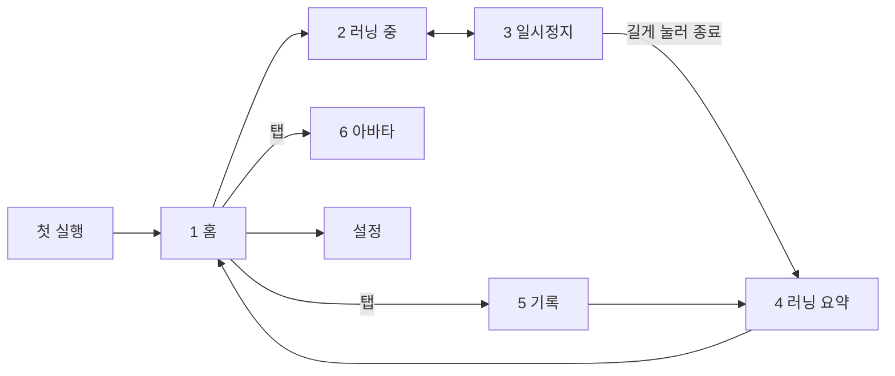

# 화면설계

> MVP 화면 6개의 역할과 이동 흐름. 배치는 [와이어프레임](../design/wireframes/README.md)을 따른다.

와이어프레임은 화면 구성을 정하는 콘티다. 실제 UI 디자인은 기능 개발 뒤에 적용한다. 와이어프레임에는 후속 범위 화면(목표 선택, 보상, 상점, 업적)도 함께 있다.

## MVP 화면

요구사항 ID는 [기획서](product.md#기능-요구사항)를 가리킨다.

| # | 화면 | 핵심 기능 | 요구사항 | 와이어프레임 |
| --- | --- | --- | --- | --- |
| 1 | 홈 | 아바타·레벨·표정, 주간 목표 진행률과 연속 달성 주수, 시작 버튼 | F1, F6, F7, F18 | 1 홈 |
| 2 | 러닝 중 | 거리 크게, 평균 페이스·시간, 달리는 아바타, 일시정지 버튼 | F1, F2, F8 | 3 러닝 중 |
| 3 | 일시정지 | 지표 요약, 길게 눌러 종료, 재개 | F1 | 4 일시정지 (지도 제외) |
| 4 | 러닝 요약 | 거리·페이스·시간, 경로 선, 구간 표, 획득 경험치·레벨업 연출, 끝부분 잘라내기 | F3, F7, F16 | 5 러닝 요약 + 6 보상 |
| 5 | 기록 | 주간 합계, 최근 러닝 목록, 러닝 삭제 | F5, F16 | 9 기록 (주간만) |
| 6 | 아바타 | 현재 레벨, 다음 외형 단계까지 남은 경험치, 외형 단계 목록 | F7 | 7 아바타 |

하단 탭은 러닝, 기록, 아바타 3개다. 다음 화면도 개발 범위지만 기본 패턴을 따르므로 와이어프레임이 없다.

- 첫 실행: 무작위로 정해진 캐릭터 소개·이름 짓기, 주간 목표 설정(3·5·10·15·20km, 결정 0011). 시안 `design/mockups/Onboarding1~3.dc.html`. 한 번만 보이고, 마치기 전에는 홈(권한 안내·기록 복구 창 포함)을 만들지 않는다. 기존 사용자도 한 번 보며, 이름은 바꾼 이름이 있으면 그대로, 목표는 지금 값이 다섯 중 하나면 그 카드가 골라져 있고 아니면 고르지 않은 채 두어 그대로 유지한다. 2·3장에서 뒤로 가기는 앞 장으로 간다.
- 권한 안내: 위치 권한, 배터리 최적화 예외 (F17)
- 설정: 체중, 주간 목표, 아바타 이름, 백업 내보내기·가져오기 (F12), 오픈소스 라이선스. 홈 오른쪽 위 톱니로 들어간다. 시안 `design/mockups/Settings.dc.html`

## 화면 이동 흐름

## UX 원칙

- **시작은 한 번의 탭**: 홈 중앙의 큰 시작 버튼 하나로 바로 달린다.
- **러닝 중엔 숫자 하나**: 거리를 화면 1/3 크기로 크게 둔다. 페이스는 GPS 오차로 흔들리는 현재 페이스 대신 평균 페이스를 보여준다.
- **실수 방지**: 종료는 길게 눌러야만 된다. 종료를 늦게 눌렀으면 요약 화면에서 끝부분을 잘라낸다.
- **요약 한 화면**: 종료 직후 기록과 성장(경험치·레벨업)을 한 화면에서 보여준다.
- **다음 단계까지 남은 양**: 레벨과 외형 단계는 다음 단계까지 남은 양을 진행 막대로 보여준다.
- **벌주지 않는 아바타**: 쉬는 날이 길어도 아바타는 졸린 표정만 짓고 레벨은 줄지 않는다.

시작 버튼, 숫자 하나, 길게 눌러 종료, 남은 양 진행 막대는 [NRC 분석](research/nrc-analysis.md)에서 가져온 원칙이다.
