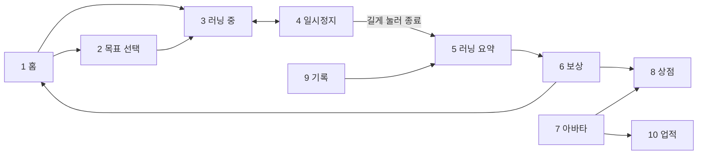

# 화면설계

> MVP 화면 10개의 역할과 이동 흐름. 배치는 [와이어프레임](https://claude.ai/artifact/GGgUf6VGKuK3AkSRxrEnoQ)을 따른다.

와이어프레임은 화면 구성을 정하는 콘티다. 실제 UI 디자인은 기능 개발 뒤에 적용한다.

## 화면 목록

요구사항 ID는 [기획서](product.md#기능-요구사항)를 가리킨다.

| # | 화면 | 핵심 기능 | 요구사항 |
| --- | --- | --- | --- |
| 1 | 홈 | 아바타·레벨 표시, 주간 목표 진행률, 시작 버튼, 목표 칩 | F1, F6, F7 |
| 2 | 목표 선택 | 거리·시간·자유 중 선택, 값 입력 | F6 |
| 3 | 러닝 중 | 거리 크게, 페이스·시간, 목표 진행률만큼 달리는 아바타, 좌우로 밀어 컨트롤·구간 | F1, F2, F8 |
| 4 | 일시정지 | 경로 지도, 지표 6개, 길게 눌러 종료, 재개 | F1, F3, F4 |
| 5 | 러닝 요약 | 거리·페이스·시간, 구간별 색상 경로, 구간 표, 자동 이름 | F3, F5 |
| 6 | 보상 | 경험치·코인 항목별 지급, 레벨업 연출 | F7, F9 |
| 7 | 아바타 | 현재 레벨, 다음 성장까지 남은 거리, 성장 단계 목록 | F7 |
| 8 | 상점 | 부위별 탭, 미리보기, 구매·장착, 해금 조건 | F10, F11 |
| 9 | 기록 | 주·월·년·전체 합계, 일별 막대 그래프, 최근 러닝 | F5 |
| 10 | 업적 | 개인 기록 3종, 배지 목록, 다음 배지 진행률 | F9 |

하단 탭은 러닝, 기록, 아바타, 상점 4개다. 첫 실행 안내, 권한 안내, 설정 화면은 기본 패턴을 따르므로 와이어프레임에서 뺐다.

## 화면 이동 흐름

## UX 원칙

Nike Run Club 화면 탐색에서 가져온 원칙이다. 상세는 [NRC 분석](research/nrc-analysis.md).

- **시작은 한 번의 탭**: 홈 중앙의 큰 시작 버튼 하나로 바로 달린다. 목표를 안 고르면 자유 러닝이다.
- **러닝 중엔 숫자 하나**: 거리를 화면 1/3 크기로 크게, 페이스와 시간은 상단에 작게 둔다.
- **실수 방지**: 종료는 길게 눌러야만 된다. 화면 잠금 토글을 둔다.
- **요약 후 상세**: 종료 직후 핵심 지표를 먼저 보여주고, 나머지는 더보기로 넘긴다.
- **다음 단계까지 남은 양**: 레벨과 배지는 다음 단계까지 남은 거리를 진행 막대로 보여준다.
- **하단 탭**: NRC의 햄버거 메뉴 대신 하단 탭으로 주요 기능을 바로 노출한다.
