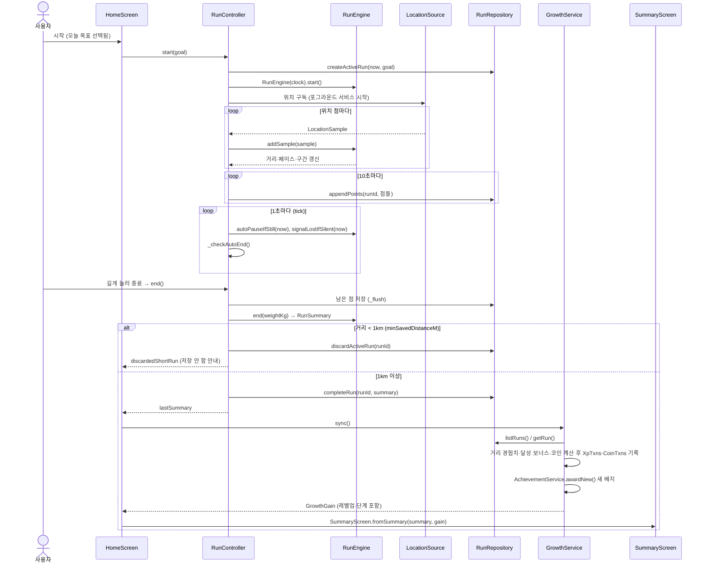
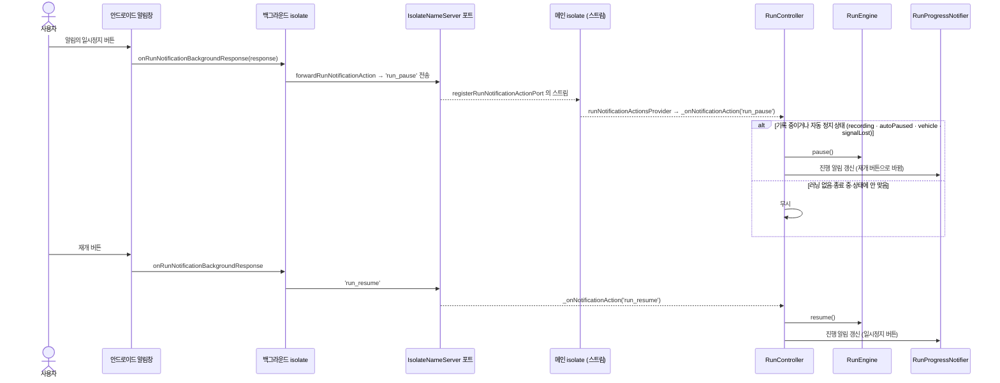
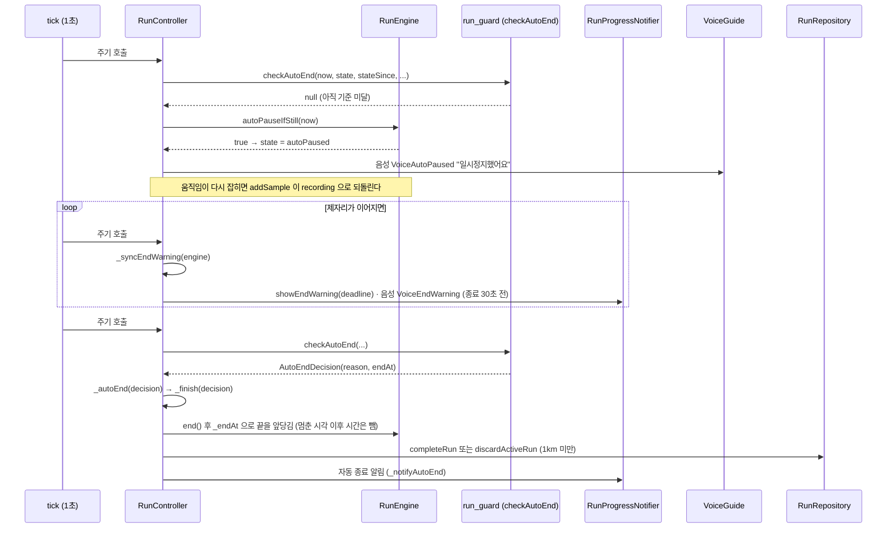
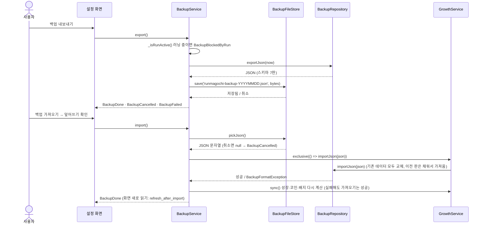

# 시퀀스 다이어그램

> 핵심 흐름 네 가지를 시간 순서로 그린다. 참여자와 메시지 이름은 실제 클래스·메서드 이름이며, 근거 파일을 그림마다 적었다 (코드 기준 2026-10-23, 앱 0.4.0). 구조는 [설계서](architecture.md), 규칙은 [기록 엔진 명세](specs/run-engine.md)·[게임 규칙](specs/game-rules.md).

## 1. 러닝 기록부터 종료·보상까지

시작 → 위치 수신 → 10초 저장 → 종료 → 요약·보상. 위치 점 하나가 거름(정확도·튀는 값·탈것)을 거쳐 거리에 더해지는 규칙은 엔진 명세에 있다.

근거: `lib/run/app/run_controller.dart` (`start`, `_finish`, `_flushInterval`, `_tickInterval`), `lib/run/ui/home_screen.dart` (`_openSummary`), `lib/avatar/app/growth_service.dart` (`sync`), `lib/achievement/app/achievement_service.dart` (`awardNew`).

## 2. 알림 버튼으로 일시정지·재개

알림 버튼 응답은 앱 화면과 다른 isolate 에서 오므로, 이름을 붙인 포트를 거쳐 메인 isolate 의 컨트롤러가 받는다.

근거: `lib/core/local_notifications.dart` (`onRunNotificationBackgroundResponse`, `forwardRunNotificationAction`, `registerRunNotificationActionPort`), `lib/run/app/run_controller.dart` (`_onNotificationAction`), `lib/main.dart` (포트 등록). 앱 프로세스가 없으면 포트가 없어 버튼을 무시한다.

## 3. 자동 일시정지와 자동 종료

1초 tick 이 상태를 판정한다. 시간 기준은 `lib/run/app/run_guard.dart` 의 값이다: 제자리 5분(`autoEndStill`)·사용자 일시정지 1시간(`autoEndPaused`)·탈것 합계 2분(`autoEndVehicle`)·시작 6시간(`autoEndMax`), 끝나기 30초 전(`autoEndWarning`)에 예고한다.

탈것 의심(30초 평균 시속 22km 초과)이 되면 구간을 기록에서 빼고, 의심 시간 합이 2분(`autoEndVehicle`)이 되면 같은 `checkAutoEnd` 가 판정해 같은 종료 흐름을 탄다(결정 0033, 예전 "시속 30km 30초" 규칙을 대체). 종료 시각은 첫 의심 구간이 시작되기 전 마지막 정상 점이다. 신호 끊김도 5분 뒤 같은 흐름으로 끝난다.

근거: `lib/run/app/run_controller.dart` (`_startTick`, `_checkAutoEnd`, `_autoEnd`, `_syncEndWarning`, `_endAt`), `lib/run/app/run_guard.dart`, `lib/run/domain/run_engine.dart` (`autoPauseIfStill`, `signalLostIfSilent`).

## 4. 백업 내보내기와 가져오기

러닝 중에는 막는다. 가져오기는 성장 계산과 같은 줄(`exclusive`)에서 DB 를 통째로 바꾼 뒤 성장을 다시 계산한다.

근거: `lib/backup/app/backup_service.dart`, `lib/backup/data/backup_repository.dart`, `lib/backup/data/backup_file_store.dart`, `lib/backup/ui/refresh_after_import.dart`. 형식 판 이력은 [데이터 모델](data-model.md#스키마-판-이력).
