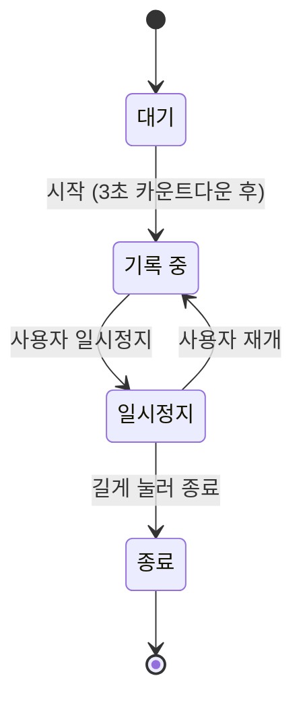

# 기록 엔진 명세

> 위치 점을 받아 거리·페이스·구간을 계산하고 이벤트를 내보내는 모듈의 동작 규칙. 화면과 분리된 독립 모듈이다.

## 상태

- **대기**: GPS 신호 세기를 확인한다.
- **기록 중**: 위치 점을 수집하고 거리를 누적한다.
- **일시정지**: 시간·거리 누적을 멈춘다. 재개는 사용자만 할 수 있다.
- **종료**: 요약을 만들고 경로를 압축해 로컬 DB에 저장한다.

자동 일시정지(F4)는 후속 범위다. 넣을 때는 자동 일시정지와 사용자 일시정지를 별도 상태로 두고, 움직임 감지로는 자동 일시정지만 풀리게 한다.

## 위치 점 처리

| 규칙 | 값 |
| --- | --- |
| 수집 주기 | 1초마다 1점, 최소 이동 거리 3m |
| 부정확한 점 버림 | 정확도가 20m보다 나쁜 점. 도심·iOS 시작 직후에 점이 과도하게 버려지는지 실측으로 확인 |
| 튀는 값 버림 | 직전 점 대비 초속 7m(시속 25km) 초과 |
| 거리 계산 | 연속한 두 점 사이 하버사인 거리의 합 |

## 계산 값

- **평균 페이스**: 움직인 시간 ÷ 총 거리. 러닝 중 화면의 기본 표시
- **현재 페이스**: 최근 30초 구간의 시간 ÷ 거리. GPS 오차로 흔들리므로 보조 표시
- **구간**: 1km마다 구간 시간·페이스를 저장하고 이벤트를 낸다. 고도는 GPS 오차가 커서 기록하지 않는다.
- **칼로리**: 체중(kg) × 거리(km) × 1.036. 체중 미입력 시 65kg

## 이벤트

| 이벤트 | 발생 시점 | 데이터 |
| --- | --- | --- |
| 상태 변경 | 상태가 바뀔 때 | 이전·현재 상태 |
| 구간 완료 | 1km마다 | km 순번, 구간 시간, 페이스 |
| 러닝 종료 | 종료 시 | Run 요약 |

## 끝부분 잘라내기

종료를 늦게 누른 경우 요약 화면에서 끝 시각을 앞당긴다. 잘라낸 뒤 거리·시간·페이스·구간을 다시 계산하고, 경험치도 다시 계산한다. 경로 압축 전 원본 점으로 계산해야 하므로 잘라내기는 요약 화면을 떠나기 전까지만 가능하다.

## 백그라운드

- **Android**: '시작' 버튼을 누를 때 위치 타입 포그라운드 서비스를 띄운다. 앱이 화면에 보일 때 시작하므로 백그라운드 위치 권한(`ACCESS_BACKGROUND_LOCATION`)은 요청하지 않는다. Android 14 이상 타깃은 Play Console 에 포그라운드 서비스 유형을 신고한다.
- **제조사 배터리 정책**: Samsung·Xiaomi 등은 앱을 강제 종료할 수 있다. 기종별 배터리 최적화 예외 안내 화면을 둔다.
- **iOS**: Background Modes의 Location updates를 켜고, 위치 권한은 '앱 사용 중'만 요청한다. geolocator 가 요구하는 Always 설명 키를 넣지 않으려면 `BYPASS_PERMISSION_LOCATION_ALWAYS` 를 설정한다.
- **강제 종료 대비**: 위치 점을 10초마다 로컬 DB에 저장해, 다시 열면 이어서 기록한다.

## 검증

- **단위 테스트**: 미리 만든 위치 점 목록으로 거리·페이스·구간 결과를 확인한다. 튀는 값, 정지, 차량 속도 구간을 포함한다.
- **에뮬레이터**: 초속 3m로 움직이는 가상 위치를 1초마다 주입해 화면을 끈 상태의 기록을 확인한다. `adb emu geo fix <경도> <위도>` 를 쓴다.
  - 사용법: `dart run tool/fake_run.dart --minutes 5 --speed 3.0 --lat 37.5260 --lng 126.9240` (끝나면 보낸 총 거리 출력, `--seconds`·`--adb <경로>` 선택)
- **실측**: 운동장 트랙 400m × 10바퀴를 달려 거리 오차를 잰다. Android와 iPhone 각 1대 이상. Android는 포그라운드 서비스만으로 화면 꺼짐 기록이 되는지 확인한다.
- **배터리**: 1시간 기록 후 감소량이 10%를 넘으면 수집 주기를 2초로 늘린다.

## 미확인

- iOS 17 이상에서 '앱 사용 중' 권한으로 백그라운드 기록을 유지하는 데 `CLBackgroundActivitySession` 이 필요한지
