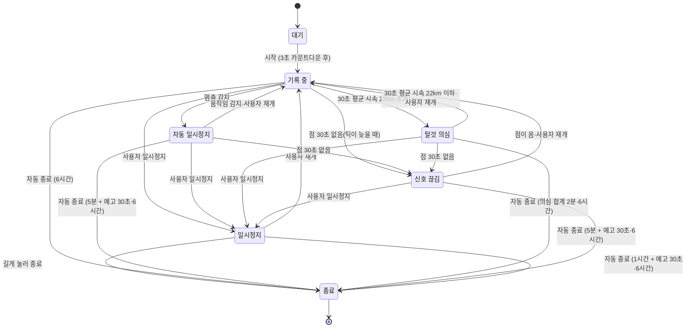

# 기록 엔진 명세

> 위치 점을 받아 거리·페이스·구간을 계산하고 이벤트를 내보내는 모듈의 동작 규칙. 화면과 분리된 독립 모듈이다.

## 상태

- **대기**: GPS 신호 세기를 확인한다.
- **기록 중**: 위치 점을 수집하고 거리를 누적한다.
- **일시정지**: 사용자가 누른 일시정지. 시간·거리 누적을 멈춘다. 재개는 사용자만 할 수 있다.
- **자동 일시정지**: 움직임이 없어 멈춘 상태. 시간·거리 누적을 멈추고, 다시 움직이면 스스로 풀린다. 판정 기준은 [결정 0020](../decisions/0020-auto-pause-idle-end.md).
- **탈것 의심**: 버스·지하철처럼 달리기로 낼 수 없는 속도로 움직이는 상태([결정 0033](../decisions/0033-abuse-signal-handling.md)). 자동 일시정지처럼 시간·거리를 멈추고, 평균 속도가 내려오면 스스로 풀린다. 아래 [탈것 의심과 신호 끊김](#탈것-의심과-신호-끊김).
- **신호 끊김**: 위치 점이 오지 않는 상태(지하철·터널, 결정 0033). 자동 일시정지처럼 시간·거리를 멈추고, 점이 다시 오면 스스로 풀린다.
- 자동 일시정지·탈것 의심·신호 끊김(`autoStoppedStates`)은 러닝 화면과 러닝 알림에 재개와 "일시정지" 버튼을 둔다. 재개를 누르면 기록 중이 되고, 일시정지를 누르면 사용자 일시정지가 된다.
- **종료**: 요약을 만들고 경로를 압축해 로컬 DB에 저장한다.
  - **1km 미만**: 자동 종료가 끝 시각을 당긴 결과까지 반영한 최종 기록 거리가 1,000m 미만이면 저장하지 않는다(`minSavedDistanceM`, [결정 0027](../decisions/0027-short-runs.md)). 진행 중 러닝과 점을 지우고(`discardActiveRun`), 요약 없이 홈으로 돌아와 "1km 미만은 기록하지 않아요" 를 띄운다. 경험치·코인·배지는 없다. 시간 목표를 채웠어도 1km 미만이면 저장하지 않는다.
  - 이 기준은 러닝이 끝나는 때만 적용한다. 저장한 뒤 요약 화면의 끝부분 잘라내기로 1km 미만이 되어도 기록은 남는다(배지는 경험치 거리로 판정해 영향이 없다).
  - 버린 러닝은 저장소에 남지 않으므로 홈의 기본 목표는 마지막으로 저장한 러닝의 목표다. 같은 앱 실행 중 사용자가 고른 목표는 그대로 유지된다.
  - 사용자 종료, 자동 종료, 강제 종료 뒤 복원(시작 6시간 초과로 바로 끝나는 경우 포함)이 모두 같다. 러닝 알림·종료 예고·음성 안내는 일반 종료와 같은 자리에서 정리한다.
- 받아들이기를 미룬 빠른 점이 이어지는 동안(마지막 미룬 점 뒤 10초 안)은 자동 일시정지하지 않는다. 차량 이동이 자동 일시정지로 끊기지 않고 탈것 의심이 된다.

## 위치 점 처리

| 규칙 | 값 |
| --- | --- |
| 수집 주기 | 1초마다 1점. 위치 스트림에 거리 거름은 두지 않는다(`distanceFilter: 0`). 멈춰 서도 점이 와서 멈춤과 신호 끊김을 구별한다 (결정 0033) |
| 최소 이동 | 기록 중 마지막 받아들인 점에서 3m(`minMoveM`) 안의 점은 받아들이지 않는다(거리·구간에 넣지 않는다). 신호로는 센다(30초 신호 끊김 판정). 엔진이 거른다 |
| 부정확한 점 버림 | 정확도가 20m보다 나쁜 점. 도심·iOS 시작 직후에 점이 과도하게 버려지는지 실측으로 확인 |
| 튀는 값 버림 | 직전 점 대비 초속 7m(시속 25km) 초과 |
| 튀는 첫 점 버림 | 기록 구간(시작·재개·자동 재개 뒤)에 점이 하나뿐이고 다음 점이 그 점에서 10초 안에 초속 7m 를 넘게 떨어져 있으면, 다음 점 대신 첫 점을 버리고 다음 점을 구간 첫 점으로 삼는다. 위치를 막 잡을 때 첫 점이 틀리기 쉽고, 남기면 뒤 점이 모두 걸러지거나 미뤄져 요약 경로에 첫 점에서 곧은 선이 그어진다. 첫 점은 거리·시간을 더하지 않았으므로 거리는 그대로다. 대신한 점을 움직인 시각으로 본다(자동 일시정지는 그 뒤 10초). 평균 속도 창은 거름 전 점이라 탈것 의심 판정은 같다. 아직 저장하지 않은 첫 점은 저장하지 않는다. 10초 주기 저장이 이미 했으면 DB 에 남지만, 받아들인 점끼리는 튀지 않으므로 복원할 때 구간 둘째 점이 첫 점에서 같은 기준으로 튀면 첫 점을 뺀다 |
| 빠른 점 미룸 | 마지막 받아들인 점에서 평균 초속 6.1m(시속 22km) 보다 빨리 멀어지는 점은 받아들이기를 미룬다. 아래 [탈것 의심과 신호 끊김](#탈것-의심과-신호-끊김) |
| 거리 계산 | 연속한 두 점 사이 하버사인 거리의 합 |

## 탈것 의심과 신호 끊김

[결정 0033](../decisions/0033-abuse-signal-handling.md). 상수는 `vehicleSpeedMps`·`vehicleWindow`·`signalLostAfter`(`lib/run/domain/run_engine.dart`), 판정은 `RunEngine.addSample`·`signalLostIfSilent` 다. 숫자는 실기기에서 조정한다(페이즈 7).

| 규칙 | 값 |
| --- | --- |
| 평균 속도 창 | 정확도 거름을 통과한 점(튀는 값 거름 전) 가운데 최근 30초 점과, 30초 전 이전의 가장 늦은 점. 창이 30초 이상일 때 첫 점과 마지막 점 사이 **직선 거리** ÷ 시간. 제자리 흔들림·굽은 길에 부풀지 않게 경로 합 대신 직선 거리를 쓴다 |
| 탈것 의심 | 기록 중 평균이 시속 22km(초속 6.1m, 1km 2분 44초) 초과. 마지막 받아들인 점(그 기록 구간에 없으면 구간을 시작·재개한 시각)으로 상태를 바꾸고 미룬 점은 버린다. 그 시각이 의심 구간의 시작이다 |
| 의심 풀림 | 평균이 시속 22km 이하로 내려온 점. 그 점 시각으로 기록 중이 되고 그 점부터 새 구간이다(의심 구간 거리·시간은 빠진다) |
| 의심 시간 | 의심 구간(시작 ~ 풀림·일시정지·신호 끊김) 길이의 합(`vehicleTime`). 첫 의심 구간의 시작이 `firstVehicleAt` |
| 신호 끊김 | 기록 중·자동 일시정지·탈것 의심에 정확도 거름을 통과한 점이 30초 없음. 마지막 점(지금 상태에 들어온 시각보다 앞이면 그 시각)으로 상태를 바꾼다. 기록 중이었으면 마지막 움직인 점이다 |
| 끊김 풀림 | 점이 오면 그 점 시각으로 기록 중이 되고 그 점부터 새 구간이다. 끊기기 전 마지막 점과의 거리는 더하지 않는다 |

- **빠른 점 미룸**: 버스가 시속 25km 아래로 달리면 점이 튀는 값 거름을 통과해 거리가 갑자기 늘어난다. 그래서 마지막 받아들인 점에서 시속 22km 보다 빨리 멀어지는 점은 바로 받아들이지 않고 미뤄 둔다. 느린 점이 오면 미룬 점과 그 점을 차례로 튀는 값 거름에 걸러 받아들이고(GPS 튐·잠깐 전력 질주), 탈것 의심이 되면 버린다. 미룬 지 30초가 지나도 의심이 아니면 받아들인다. 사용자 일시정지·종료·자동 일시정지에는 미룬 점을 버린다. 미루는 동안 화면 거리는 늘지 않는다(시속 22km 넘는 전력 질주는 거리가 늦게 보인다).
- **미루는 동안 움직인 시간**: 미루기 시작한 순간의 마지막 받아들인 점에서 움직인 시간을 멈춘다. 미룬 점을 받아들이면 그 사이 시간을 더하고, 버리면(탈것 의심·사용자 일시정지·종료) 함께 버린다. 그래서 탈것 의심이 되어도 화면 시간이 뒤로 뛰지 않는다.
- **평균 속도 창**: 자동 일시정지·탈것 의심으로 바뀌어도 이어 간다. 사용자 일시정지·재개와 신호 끊김에는 비워, 다시 30초가 찰 때까지 의심하지 않는다.
- **자동 일시정지와 겹칠 때**: 점이 끊기면 마지막 움직인 점 뒤 10초에 먼저 자동 일시정지한다(멈춰 서면 점은 오지만 3m 안이라 받아들이지 않으므로 먼저 자동 일시정지가 된다). 그 뒤 마지막 점부터 30초 동안 점이 없으면 신호 끊김으로 바뀐다. 기록이 멈춘 시각(`pausedAt`)은 처음 멈춘 시각을 그대로 둔다. 제자리 점이라도 30초 안에 오면 자동 일시정지를 유지한다. 탈것 의심 중에는 자동 일시정지하지 않는다.
- **사용자 일시정지와 겹칠 때**: 사용자 일시정지 중에는 점을 받지 않으므로 탈것 의심·신호 끊김이 되지 않는다. 의심 시간은 그대로 남아 재개 뒤 의심과 더한다.
- **화면·알림·음성**:

| 상태 | 러닝 화면 | 러닝 알림 | 음성 |
| --- | --- | --- | --- |
| 탈것 의심 | 제목 "일시정지", 무대 말풍선 "혹시 뭘 타셨나요? 이 구간은 기록에서 뺄게요" | "일시정지 · <거리>km" / 말풍선과 같은 문구 | "너무 빨라서 이 구간은 기록에서 뺄게요" |
| 신호 끊김 | 제목 "일시정지", 무대 말풍선 "신호가 끊겼어요. 밖으로 나오면 다시 찾을게요" | "일시정지 · <거리>km" / 말풍선과 같은 문구 | 말풍선과 같은 문구 |
| 신호 끊김(위치 서비스 꺼짐) | 제목 "일시정지", 말풍선 없이 빨간 카드 "위치 서비스가 꺼져 있어요. 켜면 이어서 기록해요" | "일시정지 · <거리>km" / 카드와 같은 문구 | "위치 서비스가 꺼져 있어요" |
| 풀림 | 러닝 중 | 러닝 중 | "다시 기록해요" |

- **안내 간격** (`noticeDebounce`, 60초, `lib/run/app/run_controller.dart`): 문턱 언저리 버스나 터널 입구에서 상태가 짧게 오가도 안내가 되풀이되지 않게 한다.
  - 탈것 의심이 되면 러닝 알림 본문에 의심 문구를 켜고 음성으로 읽는다. 다시 켜고 읽기는 마지막으로 켠 뒤 60초가 지나야 한다. 그 전에 다시 의심하면 문구 없이 "일시정지 · <거리>km" 와 목표 본문을 보이고, 60초가 차면 켜고 읽는다.
  - 의심이 풀리거나 다른 상태로 가면 문구를 바로 끈다. 문구는 제목과 어긋나지 않는다.
  - 신호 끊김 음성(위치 서비스 꺼짐 문구 포함)은 마지막으로 읽은 뒤 60초 안이면 읽지 않는다.
  - 풀림 "다시 기록해요" 는 그 의심·끊김을 읽었을 때만 읽는다.
  - 러닝 화면 말풍선은 늘 상태를 따른다.

- **위치 서비스(GPS) 꺼짐**: 위치 스트림이 위치 서비스 꺼짐 오류로 끊기면(`LocationServiceOffException`) 러닝 화면 위 빨간 카드 문구를 "위치 서비스가 꺼져 있어요. 켜면 이어서 기록해요" 로 바꾸고, 신호 끊김 말풍선은 숨겨 안내를 하나만 보인다. 다른 위치 오류는 "위치 신호를 받지 못하고 있어요" 카드와 말풍선을 그대로 쓴다. 상태 규칙은 같다(점이 없으니 자동 일시정지 → 30초 뒤 신호 끊김 → 5분 + 예고 30초 뒤 종료, 시간·거리 멈춤). 신호 끊김 중 러닝 알림 본문도 같은 꺼짐 문구로 바꾸고(끊긴 뒤에 꺼도 바뀐다), 음성은 신호 끊김 문구 대신 "위치 서비스가 꺼져 있어요" 를 읽는다. 음성 60초 간격, 종료 예고·자동 종료 알림 문구는 신호 끊김과 같다.
  - 끊긴 구독은 보통 5초마다 다시 하지만, 위치 서비스가 꺼져 끊겼으면 5초마다 켜졌는지만 확인하고(`LocationSource.isServiceEnabled`, 시스템 창 없음) 켜진 뒤에 구독한다. geolocator(Android)는 위치 서비스가 꺼진 채 구독하면 위치를 켜라는 Google Play 서비스 창을 띄울 수 있어(`startResolutionForResult`), 다시 구독할 때마다 창이 반복해 뜨고 위치 포그라운드 서비스가 5초마다 켜졌다 꺼진다. 화면으로 돌아올 때와 재개 버튼도 같은 확인을 거친다. 확인이 실패하면 켜진 것으로 보고 구독한다. 러닝 시작 때 처음 구독은 확인하지 않으므로, 꺼진 채 시작하면 그 창이 한 번 뜰 수 있다.
  - 점이 오면 카드를 지운다.
- 말풍선은 무대 오른쪽 위에 두고, 펫 그림을 가리지 않게(프레임 위 빈 줄까지만 겹치게) 펫 배율을 고른다. 그래도 안 들어가면 펫을 조금 가려도 말풍선을 남긴다.
- **복원**: 뺀 구간은 구간 사이 빈 곳이라 저장 형식은 그대로다. 강제 종료 뒤 복원하면 거리·움직인 시간이 같다. 의심 시간 합은 저장하지 않아 복원하면 0부터 센다. 미룬 점은 저장하지 않는다.

## 계산 값

- **평균 페이스**: 움직인 시간 ÷ 총 거리. 러닝 중 화면의 기본 표시
- **현재 페이스**: 최근 30초 구간의 시간 ÷ 거리. GPS 오차로 흔들리므로 보조 표시
- **구간**: 1km마다 구간 시간·페이스를 저장하고 이벤트를 낸다. 고도는 GPS 오차가 커서 기록하지 않는다.
- **칼로리**: 체중(kg) × 거리(km) × 1.036. 체중 미입력 시 65kg

## 이벤트

| 이벤트 | 발생 시점 | 데이터 |
| --- | --- | --- |
| 상태 변경 | 상태가 바뀔 때 | 이전·현재 상태 |
| 구간 완료 | 1km마다 | km 순번, 구간 시간, 페이스 |
| 러닝 종료 | 종료 시 | Run 요약 |

음성 안내는 이 이벤트와 상태 변경, 목표 달성, 종료 예고를 듣고 읽는다.

## 음성 안내

러닝 중 사건을 한국어(`ko-KR`)로 읽어 준다. 설정에서 끄면 읽지 않고, 기본은 켜짐이다. 다른 앱 소리는 읽는 동안 줄었다가 돌아온다(결정 0024). 문구는 `voiceLine`(`lib/run/app/voice_guide.dart`)이 만든다.

| 사건 | 문구 |
| --- | --- |
| 러닝 시작 | "러닝을 시작해요" |
| 1km 구간 완료 | "3킬로미터. 시간 18분 40초. 평균 페이스 6분 13초." (그 경계까지의 움직인 시간과 평균 페이스) |
| 오늘 목표 달성 | 거리 "목표 5킬로미터를 채웠어요", 시간 "목표 30분을 채웠어요" |
| 자동 일시정지 | "일시정지했어요" |
| 자동 재개(자동 일시정지·탈것 의심·신호 끊김에서) | "다시 기록해요" |
| 탈것 의심 | "너무 빨라서 이 구간은 기록에서 뺄게요" |
| 신호 끊김 | "신호가 끊겼어요. 밖으로 나오면 다시 찾을게요". 위치 서비스가 꺼져 끊겼으면 "위치 서비스가 꺼져 있어요" |
| 종료 예고(자동 일시정지) | "움직이지 않으면 30초 뒤 러닝을 마쳐요" |
| 종료 예고(신호 끊김) | "신호가 오래 끊겨 30초 뒤 러닝을 마쳐요" |
| 종료 예고(사용자 일시정지) | 알림과 같은 문구 "일시정지가 길어 러닝을 마쳐요. 30초 안에 재개를 누르세요" |

- 문구는 부른 순서대로 한 줄씩 읽는다. 앞 문구가 끝나야 다음을 읽고, 한 줄은 최대 15초만 기다린다.
- 켜짐 여부는 읽기 직전에 확인한다. 끈 상태, 음성 엔진 초기화 실패, 읽기 실패는 로그만 남기고 러닝 기록에는 영향을 주지 않는다.
- 단위가 0 인 시간은 읽지 않는다(`6분`). 모두 0 이면 "0초".

## 시간 목표 판정

- 시간 목표는 **확정된 움직인 시간**으로 판정한다. 자동 일시정지·사용자 일시정지로 멈춘 시간은 세지 않는다.
- 러닝 중에는 목표에 처음 닿는 순간 한 번 알린다. 강제 종료 뒤 복원한 러닝은 저장된 목표와 움직인 시간으로 같은 판정을 하고, 이미 넘었으면 다시 알리지 않는다.
- 끝부분 잘라내기로 움직인 시간이 목표 밑으로 내려가면 미달로 다시 판정한다.

## 끝부분 잘라내기

종료를 늦게 누른 경우 요약 화면에서 끝 시각을 앞당긴다. 잘라낸 뒤 거리·시간·페이스·구간을 다시 계산해 저장된 기록을 바꾸고(`replaceCompletedRun`), 경험치와 오늘 목표 달성도 다시 판정한다([게임 규칙](game-rules.md#끝부분-잘라내기)). 경로 압축 전 원본 점으로 계산해야 하므로 잘라내기는 요약 화면을 떠나기 전, 메모리에 원본 점이 있는 방금 끝낸 러닝만 가능하다(`RunEditor.trimLastRun`, `lib/run/app/run_editor.dart`).

계산 규칙 (`trimRunEnd`, `lib/run/domain/run_trim.dart`):

- 새 끝 시각이 시작보다 앞이거나 원래 끝보다 뒤면 거부한다. 원래 끝과 같으면 결과가 같다.
- 새 끝 시각보다 뒤인 점을 구간별로 버린다. 점이 없어진 구간은 사라진다.
- 남은 구간을 기록 엔진 복원 모드로 다시 돌려 거리·1km 구간·평균 페이스·칼로리를 구한다. 규칙은 기록 때와 같다.
- 움직인 시간 = 원래 움직인 시간 − 잘려 나간 기록 시간. 구간의 기록 시간은 첫 점~마지막 점이고, 마지막 구간은 원래 끝 시각까지 이어진 것으로 본다. 잘린 기록 시간은 각 구간에서 새 끝 시각 뒤에 걸친 길이의 합이다. 일시정지 중이던 시간은 세지 않는다. 0 밑으로 내려가지 않는다.
- 일시정지 중에 끝낸 기록은 마지막 구간이 끝 시각까지 이어진 것으로 보므로, 그 뒤쪽을 자르면 움직인 시간이 실제보다 조금 더 줄 수 있다.

## 자동 종료

종료를 잊고 켜 둔 러닝, 오래 멈춘 러닝(결정 0016·0020)과 탈것 의심·신호 끊김이 오래 이어진 러닝(결정 0033)을 자동으로 끝낸다. 결정 0018 의 빠른 이동 자동 종료(시속 30km 30초)는 결정 0033 의 탈것 의심으로 바뀌었다. 판정 규칙은 `checkAutoEnd`, 예고 구간은 `autoEndWarningDeadline`(`lib/run/app/run_guard.dart`)이다.

| 규칙 | 값 | 끝 시각 |
| --- | --- | --- |
| 탈것 의심 합계 | 이번 러닝의 의심 시간 합이 2분 (`autoEndVehicle`). 탈것 의심 중에만 적용, 예고 없음 | 첫 의심 구간이 시작되기 전 마지막 정상 점 (`firstVehicleAt`). 그 뒤 달린 기록도 잘린다 |
| 자동 일시정지가 이어짐 | 5분 (`autoEndStill`) 뒤 예고, 예고 30초 (`autoEndWarning`) 뒤 종료 | 기록이 멈춘 시각 (`pausedAt`) |
| 신호 끊김이 이어짐 | 자동 일시정지와 같은 5분 (`autoEndStill`) 뒤 예고, 예고 30초 뒤 종료. 끊김 상태에 들어온 시각(마지막 점)부터 센다 | 기록이 멈춘 시각 (`pausedAt`, 끊기기 직전 마지막 점 또는 그 전에 처음 멈춘 시각) |
| 사용자 일시정지가 이어짐 | 1시간 (`autoEndPaused`) 뒤 예고, 예고 30초 뒤 종료 | 기록이 멈춘 시각 (`pausedAt`) |
| 시작부터 경과 | 6시간 (`autoEndMax`), 어느 상태든 적용 | 마지막 활동 시각, 점이 없으면 지금 |

- 위 순서대로 본다. 기록 중에는 끝내지 않는다(6시간 제외). 점이 끊기면 자동 일시정지 → 신호 끊김이 되고 5분 규칙을 따른다.
- **멈춘 시간**: 지금 상태에 들어온 시각(`stateSince`)부터 잰다. 자동 일시정지는 마지막으로 움직인 점의 시각, 사용자 일시정지는 누른 시각이다.
- **자동 일시정지 → 사용자 일시정지**: 바꾼 시각부터 1시간을 다시 센다. 끝 시각은 처음 멈춘 시각 그대로다.
- **예고**: 예고 구간(5분 또는 1시간 이상, 거기에 30초를 더한 시간 미만)에 들어가면 컨트롤러가 종료 예고 알림을 한 번 띄운다. 탈것 의심 합계는 예고하지 않는다.
  - 채널 `run_end_warning`, 중요도 높음, 진동, 번호 1001
  - 끝날 시각까지 카운트다운 크로노미터
  - 자동 일시정지: 제목 "움직이지 않으면 러닝을 마쳐요", 본문 "30초 안에 움직이거나 재개를 누르세요"
  - 사용자 일시정지: 제목 "일시정지가 길어 러닝을 마쳐요", 본문 "30초 안에 재개를 누르세요"
  - 신호 끊김: 제목 "신호가 오래 끊겨 러닝을 마쳐요", 본문 "30초 안에 밖으로 나오거나 재개를 누르세요"
  - 버튼 "재개"(러닝 알림의 재개와 같은 `run_resume`)
  - 끝날 시각 5초 뒤에 알림이 스스로 사라지고, 러닝을 복원할 때도 남은 예고 알림을 지운다
  - 재개(움직임·점이 옴·버튼·화면), 상태 바뀜(자동 일시정지 → 사용자 일시정지·신호 끊김), 종료 때 지운다
  - 알림이 실패해도 러닝은 그대로 이어지고 끝난다
- **목표 달성 알림**: 종료 예고와 따로 자기 번호(1002)를 쓴다. 자동 종료 알림(1000)과도 나뉘어 있어, 러닝이 끝나면 목표 달성 알림만 지우고 방금 띄운 자동 종료 알림은 남긴다. 자동 종료 알림은 러닝 사이에는 남아 있다가 새 러닝을 시작하면 지운다(`cancelAutoEnd`). 지우지 못해도 러닝은 시작한다. 알림 번호는 `NotificationIds`(`lib/core/local_notifications.dart`)에 모여 있다.
- 자동 일시정지 중에는 러닝 화면과 러닝 알림에 "일시정지" 버튼이 있어 사용자 일시정지로 바꿀 수 있다. 오래 쉴 때 쓴다.
- **마지막 활동**(6시간 규칙): 기록 엔진이 받아들인 마지막 점과 이번 기록 구간을 시작·재개한 시각 중 늦은 쪽이다.
- **탈것 의심 합계**: 의심 시간은 벽시계로 잰다. 의심은 30초 평균으로만 시작하므로 튀는 값 하나로는 시작하지 않고, 점이 끊기면 30초 뒤 신호 끊김으로 바뀌어 의심 시간이 멈춘다.
- 컨트롤러가 1초 틱과 앱이 화면으로 돌아올 때 판정한다. 기준 시간은 `runGuardConfigProvider` 로 바꿀 수 있다(테스트·E2E 전용, 화면에서 바꾸는 곳은 없다. 아래 검증 참고).
- 끝내는 길은 사용자 종료와 같다.
  - 기록 중에 끝내면 요약을 `trimRunEnd` 로 끝 시각까지 잘라낸다.
  - 일시정지·자동 일시정지·탈것 의심·신호 끊김 중에 끝내면 움직인 시간은 멈춘 시각에서 이미 멈춰 있다. 끝 시각 뒤에 점이 없으면 끝 시각만 바꾼다.
  - 끝 시각 뒤에 점이 있으면 마지막 구간이 멈춘 시각까지 기록된 것으로 보고 `trimRunEnd` 로 잘라낸다. 멈춘 뒤 제자리에서 받아들인 점이면 점·거리를 버리고 움직인 시간은 그대로 둔다. 탈것 의심 합계로 끝내면 첫 의심 전 정상 점 뒤의 구간(의심 사이에 달린 기록 포함)을 모두 잘라낸다.
- 저장하면 "러닝을 자동으로 마쳤어요 / <거리>km 기록을 저장했어요. 요약에서 확인하세요." 알림을 바로 띄우고(탈것 의심·신호 끊김이면 "한참 못 달려서 러닝을 마쳤어요 / 기록은 안전하게 저장했어요"), 러닝 화면이 열려 있으면 요약 화면으로 간다.
- 1km 미만이라 저장하지 않으면 "러닝을 마쳤어요 / 1km 미만은 기록하지 않아요" 알림을 띄우고(이유와 상관없이 같은 문구), 러닝 화면이 열려 있으면 닫고 홈으로 돌아와 같은 안내를 띄운다.
- 강제 종료 뒤 다시 열면 복구한 러닝은 사용자 일시정지로 열리고, 복구한 시각부터 1시간 규칙을 센다. 끝 시각은 마지막 점(없으면 시작)이다. 시작 6시간을 넘었으면 이어서 기록을 묻지 않고 자동으로 끝낸 뒤 요약을 연다(끝 시각은 마지막 점, 없으면 지금). 복구 다이얼로그의 "종료하기" 도 1km 미만이면 저장하지 않는다.
- 저장이 실패하면 오류 문구를 띄운다. 마지막 점 저장이 실패했으면 틱마다 다시 시도하고, 러닝 저장이 실패했으면 사용자가 다시 종료한다.

## 백그라운드

- **Android**: '시작' 버튼을 누를 때 위치 타입 포그라운드 서비스를 띄운다. 앱이 화면에 보일 때 시작하므로 백그라운드 위치 권한(`ACCESS_BACKGROUND_LOCATION`)은 요청하지 않는다. Android 14 이상 타깃은 Play Console 에 포그라운드 서비스 유형을 신고한다.
- **제조사 배터리 정책**: Samsung·Xiaomi 등은 앱을 강제 종료할 수 있다. 기종별 배터리 최적화 예외 안내 화면을 둔다.
- **iOS**: Background Modes의 Location updates를 켜고, 위치 권한은 '앱 사용 중'만 요청한다. 위치 스트림은 `AppleSettings` 로 백그라운드 위치를 켜고 자동 멈춤을 끈다. geolocator 코드에 '항상' 요청이 있어 Always 설명 키도 넣는다 (결정 0031, [ios.md](../ios.md)).
- **강제 종료 대비**: 위치 점을 10초마다 로컬 DB에 저장해, 다시 열면 이어서 기록한다.

## 검증

- **단위 테스트**: 미리 만든 위치 점 목록으로 거리·페이스·구간 결과를 확인한다. 튀는 값, 정지, 차량 속도 구간, 신호 끊김을 포함한다(`test/run/domain/run_engine_vehicle_test.dart`).
- **에뮬레이터**: 초속 3m로 움직이는 가상 위치를 1초마다 주입해 화면을 끈 상태의 기록을 확인한다. `adb emu geo fix <경도> <위도>` 를 쓴다.
  - 사용법: `fvm dart run tool/fake_run.dart --minutes 5 --speed 3.0 --lat 37.5260 --lng 126.9240` (끝나면 보낸 총 거리 출력, `--seconds`·`--adb <경로>` 선택)
  - 멈춤: `--stop-at 60 --stop-for 120` 이면 60초째 좌표를 120초 동안 보낸 뒤 경로를 이어 간다.
  - 탈것: `--burst-at 60 --burst-for 40 --burst-speed 7` 이면 60초째부터 40초 동안 초속 7m 로 간 뒤 원래 속도로 이어 간다.
  - 신호 끊김: `fake_run` 을 멈추면(Ctrl+C) 새 좌표가 오지 않는다. 거리 거름이 없어 에뮬레이터가 마지막 좌표를 계속 보낼 수 있으니, 그러면 위치를 끈다(`adb shell cmd location set-location-enabled false`). 위치를 끄면 말풍선 대신 위치 서비스 꺼짐 카드가 보인다(위 [위치 서비스(GPS) 꺼짐](#탈것-의심과-신호-끊김)). 다시 실행하면 새 위치에서 이어진다.
- **자동 종료 확인(E2E)**: 디버그 빌드에서 `fvm flutter run --dart-define=RUN_STILL_END_SEC=30 --dart-define=RUN_PAUSE_END_SEC=60 --dart-define=RUN_END_WARNING_SEC=10 --dart-define=RUN_AUTO_END_MAX_SEC=600 --dart-define=RUN_AUTO_END_VEHICLE_SEC=20` 처럼 기준을 초 단위로 줄인다. 릴리스 빌드는 무시한다. 탈것 의심은 `--burst-*`(또는 `--speed 7`), 오래 멈춤은 `--stop-at`·`--stop-for`, 신호 끊김은 `fake_run` 을 멈춰 만든다. 탈것 판정 창(30초)과 신호 끊김(30초)은 줄이지 않는다. 신호 끊김 종료는 `RUN_STILL_END_SEC` 를 따른다.
- **실측**: 운동장 트랙 400m × 10바퀴를 달려 거리 오차를 잰다. Android와 iPhone 각 1대 이상. Android는 포그라운드 서비스만으로 화면 꺼짐 기록이 되는지 확인한다.
- **배터리**: 1시간 기록 후 감소량이 10%를 넘으면 수집 주기를 2초로 늘린다.

## 미확인

- iOS 17 이상에서 '앱 사용 중' 권한으로 백그라운드 기록을 유지하는 데 `CLBackgroundActivitySession` 이 필요한지. geolocator 는 `CLLocationManager` 의 `allowsBackgroundLocationUpdates` 를 쓰므로 필요 없다고 보고 넣지 않았다(결정 0031). iPhone 화면 꺼짐 기록으로 확인한다
