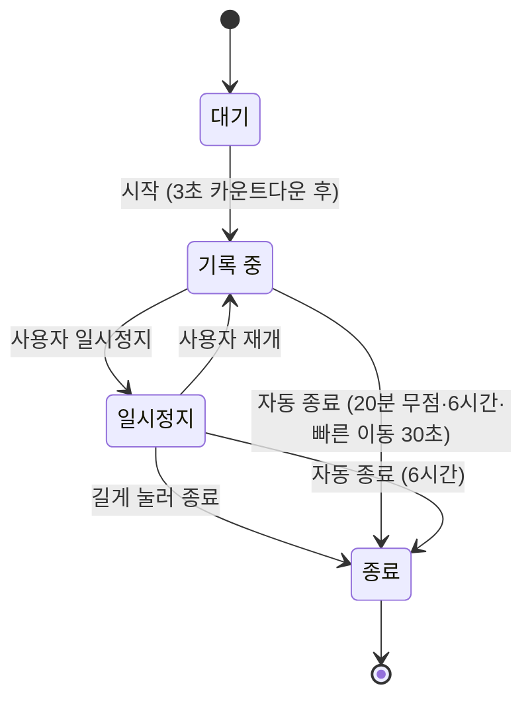

# 기록 엔진 명세

> 위치 점을 받아 거리·페이스·구간을 계산하고 이벤트를 내보내는 모듈의 동작 규칙. 화면과 분리된 독립 모듈이다.

## 상태

- **대기**: GPS 신호 세기를 확인한다.
- **기록 중**: 위치 점을 수집하고 거리를 누적한다.
- **일시정지**: 시간·거리 누적을 멈춘다. 재개는 사용자만 할 수 있다.
- **종료**: 요약을 만들고 경로를 압축해 로컬 DB에 저장한다.

자동 일시정지(F4)는 후속 범위다. 넣을 때는 자동 일시정지와 사용자 일시정지를 별도 상태로 두고, 움직임 감지로는 자동 일시정지만 풀리게 한다.

## 위치 점 처리

| 규칙 | 값 |
| --- | --- |
| 수집 주기 | 1초마다 1점, 최소 이동 거리 3m |
| 부정확한 점 버림 | 정확도가 20m보다 나쁜 점. 도심·iOS 시작 직후에 점이 과도하게 버려지는지 실측으로 확인 |
| 튀는 값 버림 | 직전 점 대비 초속 7m(시속 25km) 초과 |
| 거리 계산 | 연속한 두 점 사이 하버사인 거리의 합 |

## 계산 값

- **평균 페이스**: 움직인 시간 ÷ 총 거리. 러닝 중 화면의 기본 표시
- **현재 페이스**: 최근 30초 구간의 시간 ÷ 거리. GPS 오차로 흔들리므로 보조 표시
- **구간**: 1km마다 구간 시간·페이스를 저장하고 이벤트를 낸다. 고도는 GPS 오차가 커서 기록하지 않는다.
- **칼로리**: 체중(kg) × 거리(km) × 1.036. 체중 미입력 시 65kg

## 이벤트

| 이벤트 | 발생 시점 | 데이터 |
| --- | --- | --- |
| 상태 변경 | 상태가 바뀔 때 | 이전·현재 상태 |
| 구간 완료 | 1km마다 | km 순번, 구간 시간, 페이스 |
| 러닝 종료 | 종료 시 | Run 요약 |

## 끝부분 잘라내기

종료를 늦게 누른 경우 요약 화면에서 끝 시각을 앞당긴다. 잘라낸 뒤 거리·시간·페이스·구간을 다시 계산해 저장된 기록을 바꾸고(`replaceCompletedRun`), 경험치와 오늘 목표 달성도 다시 판정한다([게임 규칙](game-rules.md#끝부분-잘라내기)). 경로 압축 전 원본 점으로 계산해야 하므로 잘라내기는 요약 화면을 떠나기 전, 메모리에 원본 점이 있는 방금 끝낸 러닝만 가능하다(`RunEditor.trimLastRun`, `lib/run/app/run_editor.dart`).

계산 규칙 (`trimRunEnd`, `lib/run/domain/run_trim.dart`):

- 새 끝 시각이 시작보다 앞이거나 원래 끝보다 뒤면 거부한다. 원래 끝과 같으면 결과가 같다.
- 새 끝 시각보다 뒤인 점을 구간별로 버린다. 점이 없어진 구간은 사라진다.
- 남은 구간을 기록 엔진 복원 모드로 다시 돌려 거리·1km 구간·평균 페이스·칼로리를 구한다. 규칙은 기록 때와 같다.
- 움직인 시간 = 원래 움직인 시간 − 잘려 나간 기록 시간. 구간의 기록 시간은 첫 점~마지막 점이고, 마지막 구간은 원래 끝 시각까지 이어진 것으로 본다. 잘린 기록 시간은 각 구간에서 새 끝 시각 뒤에 걸친 길이의 합이다. 일시정지 중이던 시간은 세지 않는다. 0 밑으로 내려가지 않는다.
- 일시정지 중에 끝낸 기록은 마지막 구간이 끝 시각까지 이어진 것으로 보므로, 그 뒤쪽을 자르면 움직인 시간이 실제보다 조금 더 줄 수 있다.

## 자동 종료

종료를 잊고 켜 둔 러닝(결정 0016)과 차량 같은 빠른 이동(결정 0018)을 자동으로 끝낸다. 판정 규칙은 `checkAutoEnd`(`lib/run/app/run_guard.dart`)다.

| 규칙 | 값 | 끝 시각 |
| --- | --- | --- |
| 기록 중 받아들인 위치 점 없음 | 20분 (`autoEndIdle`) | 마지막 활동 시각 |
| 시작부터 경과 | 6시간 (`autoEndMax`), 일시정지 중에도 적용 | 마지막 활동 시각, 점이 없으면 지금 |
| 빠른 이동 | 연속한 두 위치 점(정확도 거름 통과, 튀는 값 거름 전) 사이 속도가 시속 30km(초속 8.33m) 를 넘는 상태가 30초 (`autoEndFast`) 이어짐. 기록 중에만 적용 | 빨라지기 전 마지막으로 받아들인 점, 없으면 이번 기록 구간을 시작·재개한 시각 |

- **마지막 활동**: 기록 엔진이 받아들인 마지막 점(정확도·튀는 값 거름 통과)과 이번 기록 구간을 시작·재개한 시각 중 늦은 쪽이다. 재개하면 20분을 재개 시각부터 다시 센다.
- 20분 규칙은 일시정지 중에는 적용하지 않는다.
- **빠른 이동**: 속도가 시속 30km 를 넘는 첫 점에서 시간을 재기 시작하고, 시속 30km 이하인 점이 오면 다시 0부터 센다. 일시정지하면 0으로 돌린다. 빠른 상태의 점들은 튀는 값 거름(시속 25km)에 걸려 거리에 들어가지 않는다.
- 컨트롤러가 1초 틱과 앱이 화면으로 돌아올 때 판정한다. 기준 시간은 `runGuardConfigProvider` 로 바꿀 수 있다(테스트·E2E 전용, 화면에서 바꾸는 곳은 없다. 아래 검증 참고).
- 끝내는 길은 사용자 종료와 같다. 기록 중에 끝내면 요약을 `trimRunEnd` 로 끝 시각까지 잘라낸다. 일시정지 중에 끝내면 끝 시각 뒤에 점이 없고 움직인 시간도 멈춰 있으므로 끝 시각만 바꾼다.
- 저장하면 "러닝을 자동으로 마쳤어요 / <거리>km 기록을 저장했어요. 요약에서 확인하세요." 알림을 바로 띄우고(빠른 이동이면 제목이 "빠른 이동이 감지돼 러닝을 마쳤어요"), 러닝 화면이 열려 있으면 요약 화면으로 간다.
- 강제 종료 뒤 다시 열 때 복구한 러닝이 시작 6시간을 넘었으면 이어서 기록을 묻지 않고 자동으로 끝낸 뒤 요약을 연다(끝 시각은 마지막 점, 없으면 지금). 일시정지 여부를 저장하지 않으므로 복구 때는 20분 규칙을 적용하지 않는다.
- 저장이 실패하면 오류 문구를 띄운다. 마지막 점 저장이 실패했으면 틱마다 다시 시도하고, 러닝 저장이 실패했으면 사용자가 다시 종료한다.

## 백그라운드

- **Android**: '시작' 버튼을 누를 때 위치 타입 포그라운드 서비스를 띄운다. 앱이 화면에 보일 때 시작하므로 백그라운드 위치 권한(`ACCESS_BACKGROUND_LOCATION`)은 요청하지 않는다. Android 14 이상 타깃은 Play Console 에 포그라운드 서비스 유형을 신고한다.
- **제조사 배터리 정책**: Samsung·Xiaomi 등은 앱을 강제 종료할 수 있다. 기종별 배터리 최적화 예외 안내 화면을 둔다.
- **iOS**: Background Modes의 Location updates를 켜고, 위치 권한은 '앱 사용 중'만 요청한다. geolocator 가 요구하는 Always 설명 키를 넣지 않으려면 `BYPASS_PERMISSION_LOCATION_ALWAYS` 를 설정한다.
- **강제 종료 대비**: 위치 점을 10초마다 로컬 DB에 저장해, 다시 열면 이어서 기록한다.

## 검증

- **단위 테스트**: 미리 만든 위치 점 목록으로 거리·페이스·구간 결과를 확인한다. 튀는 값, 정지, 차량 속도 구간을 포함한다.
- **에뮬레이터**: 초속 3m로 움직이는 가상 위치를 1초마다 주입해 화면을 끈 상태의 기록을 확인한다. `adb emu geo fix <경도> <위도>` 를 쓴다.
  - 사용법: `fvm dart run tool/fake_run.dart --minutes 5 --speed 3.0 --lat 37.5260 --lng 126.9240` (끝나면 보낸 총 거리 출력, `--seconds`·`--adb <경로>` 선택)
- **자동 종료 확인(E2E)**: 디버그 빌드에서 `fvm flutter run --dart-define=RUN_AUTO_END_IDLE_SEC=30 --dart-define=RUN_AUTO_END_MAX_SEC=120 --dart-define=RUN_AUTO_END_FAST_SEC=10` 처럼 기준을 초 단위로 줄인다. 릴리스 빌드는 무시한다. 빠른 이동은 `fvm dart run tool/fake_run.dart --speed 10` 으로 만든다.
- **실측**: 운동장 트랙 400m × 10바퀴를 달려 거리 오차를 잰다. Android와 iPhone 각 1대 이상. Android는 포그라운드 서비스만으로 화면 꺼짐 기록이 되는지 확인한다.
- **배터리**: 1시간 기록 후 감소량이 10%를 넘으면 수집 주기를 2초로 늘린다.

## 미확인

- iOS 17 이상에서 '앱 사용 중' 권한으로 백그라운드 기록을 유지하는 데 `CLBackgroundActivitySession` 이 필요한지
