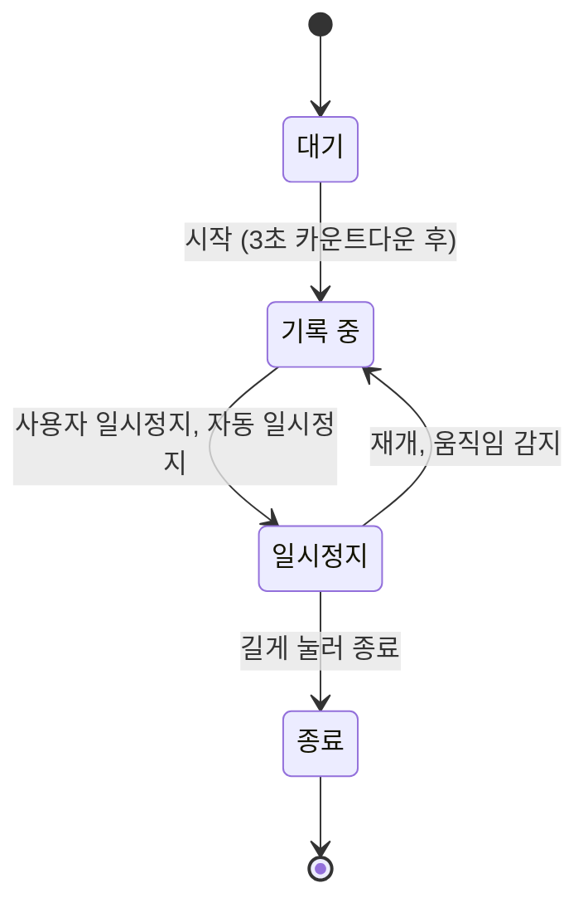

# 기록 엔진 명세

> 위치 점을 받아 거리·페이스·구간을 계산하고 이벤트를 내보내는 모듈의 동작 규칙. 화면과 분리된 독립 모듈이다.

## 상태

- **대기**: GPS 신호 세기를 확인한다.
- **기록 중**: 위치 점을 수집하고 거리를 누적한다.
- **일시정지**: 시간·거리 누적을 멈춘다.
- **종료**: 요약을 만들고 로컬 DB에 저장한다.

## 위치 점 처리

| 규칙 | 값 |
| --- | --- |
| 수집 주기 | 1초마다 1점, 최소 이동 거리 3m |
| 부정확한 점 버림 | 정확도가 20m보다 나쁜 점 |
| 튀는 값 버림 | 직전 점 대비 초속 7m(시속 25km) 초과 |
| 거리 계산 | 연속한 두 점 사이 하버사인 거리의 합 |
| 자동 일시정지 | 5초 동안 초속 0.5m 미만이면 멈춤, 초속 1m 이상이면 재개 |

## 계산 값

- **현재 페이스**: 최근 30초 구간의 시간 ÷ 거리
- **평균 페이스**: 움직인 시간 ÷ 총 거리
- **구간**: 1km마다 구간 시간·페이스·고도 변화를 저장하고 이벤트를 낸다.
- **칼로리**: 체중(kg) × 거리(km) × 1.036. 체중 미입력 시 65kg

## 이벤트

| 이벤트 | 발생 시점 | 데이터 |
| --- | --- | --- |
| 상태 변경 | 상태가 바뀔 때 | 이전·현재 상태 |
| 구간 완료 | 1km마다 | km 순번, 구간 시간, 페이스 |
| 목표 달성 | 목표 거리·시간 도달 | 목표 종류, 값 |
| 러닝 종료 | 종료 시 | Run 요약 |

## 백그라운드

- **Android**: 위치 타입 포그라운드 서비스와 상시 알림. 배터리 최적화 예외 안내 화면을 둔다.
- **iOS**: Background Modes의 Location updates를 켠다. 위치 권한은 '앱 사용 중'으로 충분하다.
- **강제 종료 대비**: 위치 점을 10초마다 로컬 DB에 저장해, 다시 열면 이어서 기록한다.

## 검증

- **단위 테스트**: 미리 만든 위치 점 목록으로 거리·페이스·구간·자동 일시정지 결과를 확인한다. 튀는 값, 정지, 차량 속도 구간을 포함한다.
- **에뮬레이터**: 초속 3m로 움직이는 가상 위치를 1초마다 주입해 화면을 끈 상태의 기록을 확인한다. 방법은 [NRC 분석](../research/nrc-analysis.md)과 같다.
- **실측**: 운동장 트랙 400m × 10바퀴를 달려 거리 오차를 잰다. Android와 iPhone 각 1대 이상.
- **배터리**: 1시간 기록 후 감소량이 10%를 넘으면 수집 주기를 2초로 늘린다.
