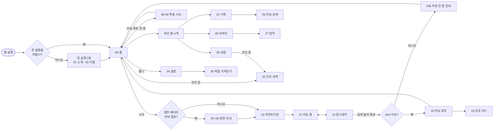
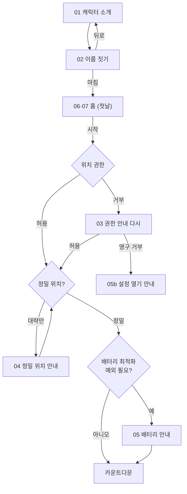
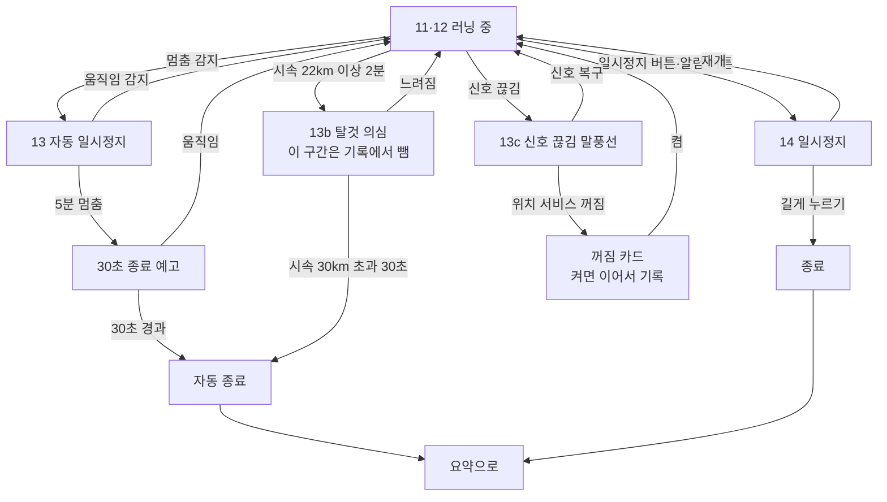
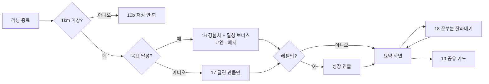
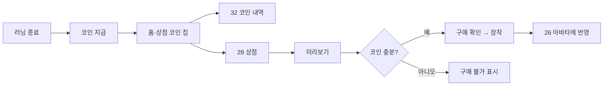
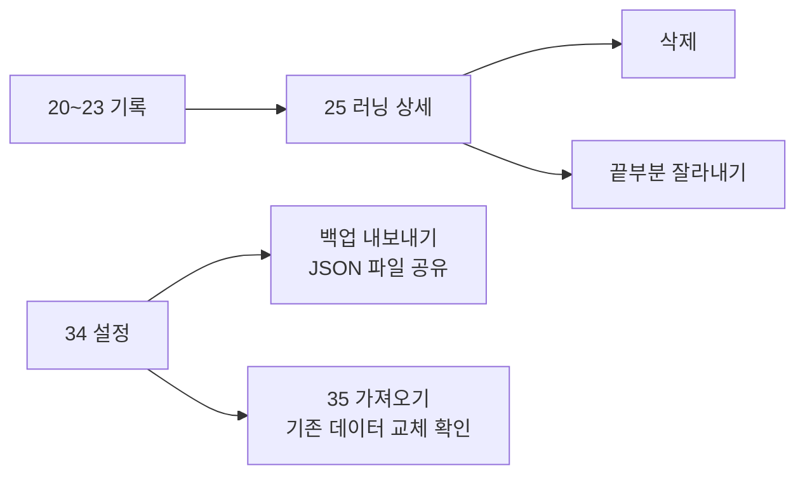

# 유저 시나리오와 사용자 흐름

> 핵심 루프는 **달리기 → 아바타 성장 → 다시 달리기**다. 시나리오 S1~S5 를 현재 앱(0.4.0, 2026-10-23) 기준으로 쓰고, 예외 흐름과 화면 이동을 다이어그램으로 보인다. 요구사항 ID 는 [기획서](product.md#기능-요구사항), 화면 번호는 [화면설계서](screens.md) 컷 번호(`design/screens/<번호>-<이름>.png`)다.

## 사용자

| 사용자 | 상황 | 바라는 것 |
| --- | --- | --- |
| 입문 러너 | 달리기를 시작했지만 꾸준히 못 이어간다 | 오늘 얼마나 달릴지 쉽게 정하고, 달린 만큼 눈에 보이는 보상을 받는다 |
| 게임을 좋아하는 러너 | 기록 숫자만으로는 동기가 약하다 | 캐릭터가 자라고 꾸며지는 재미 |

## 전체 화면 이동

## S1. 첫 실행 (F7, F17)

1. 무작위로 정해진 캐릭터(병아리·젤리·도토리)를 만나고 이름을 짓는다.
2. 처음 러닝을 시작할 때 위치 권한을 허용한다. 허용 전에 왜 필요한지 안내 화면을 보여 준다.

- 예외: 영구 거부(Android 는 두 번 거부)면 "설정에서 위치 권한을 허용해 주세요" 와 `설정 열기` 로 바뀐다.
- 기존 사용자도 업데이트 뒤 첫 실행 2장을 한 번 본다. 이름은 이미 바꾼 이름이 있으면 그대로 둔다.

## S2. 러닝 기록 (F1~F4, F6, F14, F20)

1. 홈에서 오늘 목표(거리 3~42km 또는 시간 15~180분)를 고르고 시작한다. 목표는 지난번 값이 골라져 있어 바로 시작할 수 있다.
2. 3초 카운트다운 뒤 기록이 시작된다.
3. 러닝 중 화면에 거리, 목표 진행, 페이스, 시간과 달리는 아바타가 보인다. 목표에 닿으면 진동과 "목표 달성!" 이 한 번 나오고 기록은 이어진다. 구간마다 음성으로 알려 준다.
4. 화면을 꺼도 기록은 이어지고, 알림창·잠금화면에 거리·시간·목표 진행이 보인다. 알림 버튼으로 일시정지·재개한다.
5. 종료는 일시정지 화면에서 길게 눌러서만 한다.

- 앱이 강제 종료돼도 10초마다 저장한 점으로 복구 안내를 보여 준다 (결정 0007).
- 탈것·신호 끊김은 벌점 없이 말풍선으로만 알린다 (결정 0033).

## S3. 러닝 종료와 성장 (F3, F7, F9, F16, F19, F21)

1. 러닝이 끝나면 요약 화면에서 거리, 페이스, 경로 선(페이스별 색), 구간을 본다. 1km 미만이면 저장하지 않고 안내만 나온다 (결정 0027).
2. 거리 경험치와 목표 달성 보너스가 쌓이고, 코인과 새 배지를 받고, 레벨업하면 성장 연출이 나온다. 목표를 못 채웠으면 달린 만큼만 받는다.
3. 종료를 늦게 눌렀다면 끝부분을 잘라낸다. 거리 경험치와 달성이 다시 판정된다.
4. 공유 버튼으로 아바타와 기록이 담긴 이미지 카드를 카카오톡·인스타그램 등에 보낸다.

## S4. 쉬는 날 (F18)

1. 마지막 러닝 뒤 며칠이 지나면 홈의 아바타가 졸린 표정을 짓는다. 벌점은 없다.
2. 다시 달리면 원래 표정으로 돌아온다.

## S5. 보상과 꾸미기 (F9~F11, F19)

1. 러닝 결과에 따라 코인을 받는다(거리, 목표 달성, 배지).
2. 상점에서 아이템을 누르면 내 아바타에 입힌 미리보기가 보인다.
3. 코인으로 구매하고 바로 장착한다. 벗기도 할 수 있다.

## S6. 기록 관리와 백업 (F5, F12, F16)

1. 기록 탭에서 주·월·년·전체 합계와 최근 러닝을 본다. 러닝을 눌러 상세(경로 선·구간 표·페이스 그래프)를 보고 삭제하거나 끝부분을 잘라낸다.
2. 설정에서 백업 파일을 내보내고, 새 기기에서 가져온다. 가져오면 기존 데이터를 모두 바꾼다 (결정 0015).

